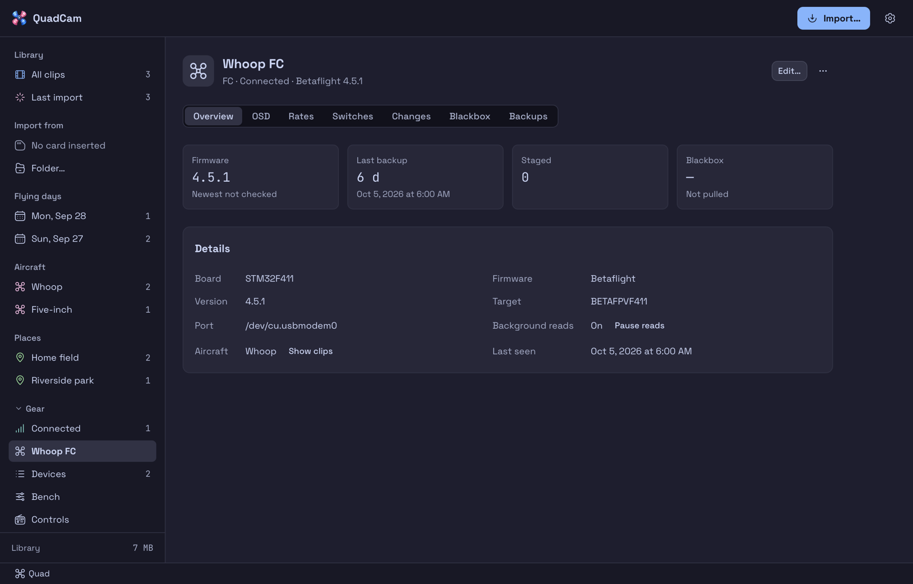

# Gear

Gear is QuadCam's second half: the FPV bench next to the clip library. This page covers what
works today. The full plan is in [Gear design](gear-design.md).

First time on real hardware? Follow the ordered checklist in [Device trials](trials.md).

## In the app

**Gear** is a section of the sidebar, under the library groups. Its triangle opens and closes
it.

**The status bar** along the bottom of the window has one item per kind of device plugged in:
Radio, Quad, DJI (a goggles card or an air unit), DVR card and ExpressLRS. Each shows its icon,
its name and its state: **Working** (a job runs), **Safe to unplug** (unmounted or released),
**Still inserted** (unmounted, still in after its reminder time; **Dismiss** stops the
reminder) or **Needs attention** (a failed step, or a device to save). A click opens the
device, or Connected when several of that kind are in. VoiceOver reads each change of state.
With nothing plugged in the bar stays and says "No gear connected".

- **Connected** shows what is plugged in now. One line under the title counts the devices
  plugged in, those that need attention, those working and the changes staged. A card per
  device, those that need you first, shows its state, a line of facts (kind, firmware, last
  backup, card space) and its next step (**Save…**, **Review…**, **Import…**). The card's
  **…** menu holds **Open**, **Mount**, **Prepare card…**, **Edit…** and **Forget…**. Each
  device also has its own row under Connected in the sidebar.
- **Devices** is a table of the devices you saved, plugged in or not, grouped by kind (Radios,
  Quads, Goggles and cards, ExpressLRS): aircraft, state, last backup, firmware and staged
  changes. A device that is not plugged in shows its state in muted text. An **Update** badge
  beside the firmware opens Firmware. Each row's **…** menu holds **Open**, **Back up now**,
  **Edit…** and **Forget…**.
- **Bench** lists the changes staged for each device. See [The Bench](#the-bench).
- **Pack up**, **Flights**, **Packs** and **Repairs** are described under
  [Flights and packs](#flights-and-packs).
- **Controls** shows the radio's sticks and switches live. See [Controls](#controls).
- **Voices** holds the voice packs on this Mac, ElevenLabs and the other voices. See [Voices](#voices).
- **Firmware** compares each device's firmware with the newest release. It reads a radio's
  firmware, flashes an EdgeTX radio, and, with the previews on, flashes a Betaflight FC and
  reads ExpressLRS devices. See [Firmware and splash](#firmware-and-splash).
- **Storage** shows the gear folder. See [Backups](#backups).
- **Sim** has three sections: **Fly** (only while **Show the Sim page** is on, see
  [Sim](sim.md)), **Radio** (the sim's radio calibration, see [Sim](sim.md)) and **Rates** (the
  sims on this Mac against one quad's rates, see [Sims](#sims-page)). The item says **Out of
  date** while a sim's rates differ from the quad's.
- A device's page shows its kind, state and firmware in the header. Its Overview has summary
  tiles: for an FC the firmware (against the newest), the last backup, the staged changes and
  the latest blackbox pull; for a radio the same with its aircraft count in place of the
  blackbox; for a DVR or goggles card the new clips, the last card check, the free space and
  the last backup. A tile opens the section it sums up. **Details** lists what the device
  reports about itself (board, firmware, version), where it is mounted and its aircraft.
  **Save…** names a device QuadCam does not know and links an FC to its aircraft; **Edit…**
  changes that; **Forget…** (in the **…** menu) removes it from `gear.json` and keeps its
  backups. **Show clips** opens the aircraft's clips.
- A radio flies many aircraft, so its page lists them under **Aircraft on this radio**: every
  aircraft profile that names the radio, with its EdgeTX model, whether that model is on the
  mounted card (else in the latest backup), and **Selected** on the model the radio selects.
  **Add aircraft** and **Remove** set or clear the profile's radio. **Settings > Aircraft**
  edits the same field (**Radio**, **EdgeTX model file**), so the two always agree.

The bar along the bottom of the window shows one item for each kind of device plugged in:
radio, quad, DJI and DVR card. Click one to open the device, or the Connected list when there
are several. Each item shows a state:

| State | Means |
|---|---|
| Working | A QuadCam job is using the device |
| Safe to unplug | The card is unmounted and still in |
| Still inserted | The "still inserted" reminder is due. **Dismiss** (**Dismiss reminder** on the device page) stops it |
| Needs attention | QuadCam does not know the device yet: save it |
| Connected | Plugged in, nothing to do |

Settings for backups, steps on connect and cues are in **Settings > Gear**
([Settings](settings.md#gear)).

## What QuadCam finds

QuadCam looks for gear every 2 seconds while the app runs. Finding gear opens no port and
writes to no device. The one exception is the USB timer for flight controllers (below): it
reads the battery voltage over MSP every 30 seconds and closes the port again.

| Device | How QuadCam finds it |
|---|---|
| EdgeTX radio | Its SD card in USB Storage mode, or its card in a reader. QuadCam reads `board` and `semver` from `RADIO/radio.yml`. A volume on the radio's own USB device (vendor `OpenTX` or `EdgeTX`, or a radio maker in the product name) is the radio itself, and shows its USB details |
| EdgeTX radio, serial | The radio's USB serial port (`<Maker> <Radio> Serial Port`). It is a radio, not a flight controller |
| Goggles | A DJI volume: a goggles card, or an air unit over USB (DJI clips under `DCIM/DJI_*`) |
| DVR card | A card with analog clips, from a DVR or analog goggles |
| Flight controller | A USB serial port with an STM32 or AT32 virtual COM port id |
| ELRS module | A USB serial port with a CP210x, CH340 or CH9102 id |
| Radio in DFU mode | The STM32 bootloader (`0483:df11`) |

When nothing shows, QuadCam says: "Nothing found. If macOS asked to allow an accessory, click
Allow." macOS keeps a new USB accessory off until you allow it, and QuadCam cannot see that
question.

A card in the built-in SD slot gets its id from a hash of the card's own serial number, so a
format keeps it. A radio card with QuadCam's marker file (`.quadcam-id`) gets its id from that
file. Other cards and radios get theirs from a hash of the volume UUID. A flight
controller gets its id when QuadCam identifies it: a hash of the MCU's unique id, which MSP and
the CLI's `mcu_id` both report. An FC that reports none gets a hash of its board name and USB
serial number. The raw id never leaves the Mac.

A radio in USB Storage mode reports a USB serial number, but EdgeTX radios all report the same
generic one, so QuadCam does not use it as an id. It identifies the radio by its card.

**One radio, two ids.** A radio card in the built-in SD slot gets its id from the card's
hardware serial, which the radio's USB Storage mode does not show. There the id comes from the
volume UUID. When QuadCam sees a saved radio's card, it also records the other ids the card
answers to (`aliases` in `gear.json`). The same card, plugged in through the radio, is then the
same saved radio, with its name, aircraft and backups.

**DFU link.** In DFU mode the bootloader reports the chip's own serial number, which is a
stable id, but no name. QuadCam cannot match it to the storage-mode radio by itself, so the
serial is linked to a saved radio once and kept in that radio's record:

- `gear dfu-link --device RADIO` links the radio now in DFU mode to the radio you name.
  Without `--device` QuadCam takes the saved radio seen most recently and says so. A serial
  belongs to one radio; linking it to another moves it. `--unlink` removes it.
- A flash plan checks the link. A DFU device linked to another radio, or a radio linked to
  another DFU device, refuses ("The radio in DFU mode is this radio"). An unlinked DFU device
  passes with a warning that names the radio seen most recently; a verified flash then links
  it to the radio you flashed.
- Once linked, the DFU device shows in the device list under the radio's name.

## Flight controllers



QuadCam talks to Betaflight over USB in two ways:

- **MSP** (identify): board, firmware, version, maker, the cloud build key, the device id. No
  reboot.
- **The CLI** (read): `version`, `status`, `diff all`, `dump all`, `get NAME`. When the read
  ends, QuadCam leaves the CLI and the FC reboots, as it does in the Betaflight Configurator.

Every job opens the port, works, and closes it. QuadCam never keeps an FC port open between
jobs, so another app can use it, and the FC can be unplugged as soon as the job says "done".

**Sharing the port with another tool.** Two programs talking MSP and the CLI on one port garble
each other: QuadCam's MSP frames (`$M<`) land in the other tool's CLI replies. So QuadCam opens
a port only when no other program has it open:

- Before each open it asks macOS which processes have the port's device nodes open
  (`/dev/cu.*` and its `/dev/tty.*` twin; the same data `lsof` shows, read in place). If one
  does, QuadCam does not open the port. A job you start says "port busy" and names the
  program. A background read (the USB timer's battery probe, the on-connect backup) skips quietly
  and tries again later.
- QuadCam opens the port exclusively (`TIOCEXCL` and a file lock), so a tool that starts in the
  middle of a read gets "busy" instead of sharing it, and closes it again within a second.
- QuadCam's own background reads are the USB timer's probe (every 30 s), the on-connect FC
  backup and a live switch read. Each opens, reads, and closes.
- The check sees programs of your own user account. If a tool runs as another user, or you want
  no chance of a probe at all, pause the reads: **Pause reads** on the FC's Overview, `gear fc
  pause` in the CLI, or `poll_pause` in `quadcam_gear_edit`. The USB timer stops counting while
  paused, and the pause lasts until QuadCam quits. A job you start yourself still runs.
- A pause also turns off the USB heat checks, because they read the timer. A job still reads
  the battery once before its heat check: with a battery in and no timer counting, a flash
  refuses, and an apply or a blackbox pull warns in its answer.

Plug USB in before the battery: many FCs do not show up on USB when the battery is first.
When several FCs are plugged in, name the port; QuadCam does not guess.

**Writes.** QuadCam writes an FC only through a staged change that you apply. It writes
only boards and Betaflight builds it has tested; any other FC is read-only, and QuadCam says
why ("Board X is not proven."). Today these are proven:

| Board | Betaflight build |
|---|---|
| `BETAFPVG473_V2` | 2026.6.0 |
| `BETAFPVG473` | 2025.12.5 |

**Known issues.** QuadCam lists known issues of some boards and builds on the device and after
each job on it. For example, one 2025.12.5 build leaves the beeper silent after a USB session
until the battery is plugged in again.

**USB timer.** A small quad on USB with its battery in has no airflow and heats fast. While an
FC is on USB with a battery in (more than 1 V on its battery lead), QuadCam counts the minutes.
At the limit it says "Unplug <FC> now." once, and the device shows the time left. The limit is
the `gear_usb_minutes` setting (20), or the board's own limit when it is shorter (10 minutes for
the boards above). `gear_usb_minutes` 0 turns the timer off. Pulling the battery resets it.
The timer follows the FC, not one detection poll: it keeps counting while the port drops out for a
reboot after a job, for USB disk mode or for a flash. It ends once the port has been gone for a
minute, or for 15 minutes while a DFU device is attached (an FC in its bootloader).

## Blackbox

An FC with a flash chip logs its flights to it. When the flash is full, Betaflight stops logging, so
the next flights leave no log. QuadCam pulls the logs off the flash and, if you allow it, erases
the flash afterwards.

**The segment.** An FC's **Blackbox** segment shows tiles: **Flash used** (bytes used of the
flash size, and whether a stored pull holds them), the pulls, the last pull and its logs. While the
FC is plugged in, QuadCam reads the flash size and use over one MSP message (`gear blackbox
summary`, MCP `blackbox_summary`): no pull, no cue. It skips that read while a job runs or the
port's reads are paused. Pick a pull to see its logs and the flight each one is paired with.

**Pull.** **Pull blackbox** on the FC's **Blackbox** segment (also `gear blackbox pull`, and the
on-connect step below) does this in one job:

1. Reads the flash summary over MSP: size, bytes used, ready.
2. Reads only the used bytes, 4 KB at a time, with the compression flag off. MSP gives about
   84 KB/s, so a full 16 MB flash takes about 3.3 minutes. A chunk that fails is asked again
   twice; a plug pulled mid-read fails the job.
3. Checks the image. Its size must equal the used bytes, it must start with a log header, and
   each log needs a firmware line. QuadCam counts the logs and reads the firmware, the craft
   name and the log date from the headers.
4. Stores the image in the gear folder's blob store and reads it back. A record in
   `<gear>/blackbox/<device>/` ties it to the FC, its aircraft and the day, and names the logs.
   A pull of the same bytes as the last one adds no second record.
5. Erases the flash only if all of the above passed and the **Erase blackbox after download**
   setting (`gear_erase_blackbox`) is on. It waits until the flash reads ready with 0 bytes used.
   A flash that grew since the read is not erased.

"Done, safe to unplug." plays after step 5 ends, not before. If the erase does not finish, the job
fails, the pull stays stored, and the record says why.

`gear_erase_blackbox` is off by default, like `delete_clips_after_import`. The CLI and the MCP tools
only respect it: `--keep` (CLI) and `keep` (MCP) skip the erase for one run, and nothing turns it on
except the setting. MCP `blackbox_pull` needs `confirm=true`; CLI `gear blackbox pull` needs no
`--yes`, so with the setting on it erases after a verified pull. **Erase flash** (`gear blackbox erase --yes`, `blackbox_erase`) erases by hand.
It needs a stored pull of exactly what the flash holds (the same used size; flash only grows), and
asks first in the app.

**USB heat.** A quad on USB with its battery in heats up. When the timer (see
[Flight controllers](#flight-controllers)) shows less time left than the read needs, the pull is
refused ("USB heat") and reads nothing; unplug the battery, or force the pull (`gear blackbox pull
--force`). A forced pull still
never starts an erase it could not finish: the erase estimate (4 s per MiB, 20 to 120 s) plus 10 s
must fit in the time left, else the erase is skipped and the answer says so. With no battery in,
there is no timer. With a battery in and no timer counting (reads paused, or the FC plugged in
moments ago), the pull runs and its answer warns.

**Other programs and Pause reads.** A pull refuses a port another program has open. The on-connect
step skips a port whose reads you paused; a pull you start yourself still runs.

**Steps on connect.** `blackbox` is a step in `gear_on_connect` for FCs. It is off until you pick
**Pull blackbox** in the FC pop-up of **Settings > Gear > When a device is plugged in** (or list
`blackbox` in `gear_on_connect.fc`).

**Dates and flights.** A flight controller has no clock, so its logs read `0000-01-01`. QuadCam
dates a pull by the day it ran. If the FC is linked to an aircraft (Overview, or `gear devices
save --aircraft`), the Blackbox segment pairs the pull's logs with that aircraft's flights from the
radio logs **by order**, newest log with newest flight, since the previous erased pull. This is a
guess: the segment's column reads "Flight, paired by order". Logs under 32 KB (test arms) are skipped. Pairs whose size per
second of flight differ from the others by more than 2 times are marked "Size does not fit". QuadCam
does not decode the flight data yet.

**USB disk mode (not proven).** With `gear_blackbox_msc` on (**Read through USB disk mode
first (not proven)** in Settings > Gear), a pull first tries the FC's USB mass
storage mode: it enters the CLI, checks that `help` lists `msc`, sends `msc`, copies the `.bbl` files
from the new disk in name order, unmounts it, and waits for the FC to come back. It falls back to
MSP when the FC has no `msc`, and when the disk's files do not verify as the flash (not the bytes
used, or a log without a header): the answer says why. With `--mode msc` it fails instead. This
path is built and tested on a simulated FC only. **It needs a trial
on a real FC**: the disk's file layout, the speed, and whether the FC returns to serial after the
eject are unknown. The estimate for the heat check stays the MSP one.

**Export.** `gear blackbox export <id> DIR [--split]` writes the image as `.bbl`, and with `--split`
each log as its own file. It never overwrites.

**CLI and MCP.** `gear blackbox list|pull|erase|export` covers the job. `gear blackbox pull
--mode` picks MSP or USB disk mode for one run. The MCP `blackbox_pull` takes `mode`, `keep` and
`force` the same way. In MCP, `quadcam_gear` `blackbox` lists the
pulls, `quadcam_gear_apply` `blackbox_pull` and `blackbox_erase` write (both need `confirm`), and
`quadcam_gear_edit` `blackbox_export` exports.

## Saved devices

QuadCam keeps the devices you name in `gear.json`, in the gear folder:

```
~/Library/Application Support/app.quadcam/gear/gear.json
```

The `gear_dir` setting moves the gear folder. `gear.json` follows the same rules as the settings
file: every writer changes only what it was asked to change, keeps every other key, and the
running app sees a change from the command line or an agent within 2 seconds.

An aircraft profile can name its gear (`gear`: `fc`, `radio`, `edgetx_model`, `rx`,
`pack_type`). Profiles without it load and save as before.

A device record links an FC to its one aircraft (`aircraft`). A radio keeps no aircraft of its
own: the profiles that name it in `gear.radio` are its aircraft, and reads list them in
`radio_aircraft` (never saved). A read fills a radio's `aircraft` with the one whose EdgeTX
model the radio selects (as the mounted card, else the latest backup, shows it), or none. A `gear.json` from 0.11 or earlier may hold a radio linked to
one aircraft. QuadCam moves that link the first time it reads the file: the profile gets the
radio when it names no radio yet, and the radio's `aircraft` is cleared. A link the profile
cannot take (it names another radio, or the profile is gone) stays in the radio's entry as
`legacy_aircraft`.

## EdgeTX cards

QuadCam reads an EdgeTX SD card, in the radio over USB or in a card reader:

- the board and EdgeTX version, and whether QuadCam may write this pair. EdgeTX 2.12 on the
  RadioMaster Pocket is proven; other pairs are read only;
- the models, and the model the radio has selected, with the aircraft profile that names it
  (its `edgetx_model` file, or one of its EdgeTX model names). The app can then warn when
  the radio is set to another quad than the one just connected;
- the radio clock: a log dated 2000-01-01 means the clock was reset, so its clock battery may
  be dead;
- one model in full: timers, mixes, logical switches, special functions, switch warnings,
  telemetry sensors and screens.

QuadCam can also preview card edits: the checks and a line diff, and how long the write would
take. A preview writes nothing. Edits change only the lines they must; every other line stays
byte for byte, line endings included. They never change the radio's selected model unless
the edit asks for it. The power-on checklist is a model setting QuadCam turns on or off.

QuadCam writes the edits through a staged change. See
[Radio cards](#radio-cards).

**Over the radio's USB, writes are slow** (about 0.3 MB/s, a 37 MB voice pack in about 2
minutes). QuadCam writes one file at a time under a temporary name and renames it, so the
card is always whole. Cancel finishes the current file, then unmounts the card, then says
"safe to unplug". Do not pull the radio while a file is being written: once, that wedged the
Mac's disk service until a reboot. If macOS stops answering, QuadCam says a reboot may be
needed instead of waiting forever.

While a write runs over the radio's USB, the apply sheet says to keep the radio plugged in.
QuadCam never asks you to unplug it before the unmount. A mount or unmount that macOS does not
finish within its time limit (60 seconds for an unmount) ends with "macOS did not finish ...
a reboot may be needed" and leaves the radio plugged in.

A file write that macOS does not finish within its time limit keeps running. QuadCam starts no
other file and waits for that write to end (up to 2 minutes over the radio's USB) before it
puts files back. If the write is still running after that wait, QuadCam puts nothing back and
leaves the card mounted. The sheet names the backup to restore. Keep the radio plugged in until
it responds again, press **Done** on its Gear page, then restore that backup.

If the radio's firmware stops at an error, hold both horizontal trims inward while you power
it on. The bootloader then shows the SD card over USB.

### Clean ._ files

macOS writes hidden `._*` files (AppleDouble) next to files it copies to a FAT card. The radio
does not use them. QuadCam removes the `._` file beside every file it writes, and does not
create the others. For files that are already there, **Clean ._ files** on the radio's
**Backups** segment lists them, asks, then deletes them and unmounts the card. It deletes only
files that start with the AppleDouble header; a file you named `._notes` stays. It deletes only
on a card Gear detects or a folder that is an EdgeTX card (`RADIO/radio.yml` or `MODELS/`). On
the command line: `gear card-clean --device ID` lists, `--remove --yes` deletes.

### Radio over USB Serial

With the radio's USB serial port set to **CLI** (the hardware settings, `serialPort: VCP`),
the radio shows as a serial port (`<Radio> Serial Port`, 115200 baud, prompt `>`). It is a
radio, not a flight controller. The CLI cannot move file contents, so QuadCam uses it for small
jobs only. `gear radio-cli ACTION` runs one:

| Action | What it does |
|---|---|
| `identify` | `ver`: the board and EdgeTX version the radio runs, and the saved radios of that board |
| `ls --path /SOUNDS/en` | lists a card folder |
| `play --path /SOUNDS/en/hello.wav` | plays a sound file on the radio's speaker. A voice line's card path works as it is, so after a voice pack is applied you can hear a line on the radio itself |
| `beep` | the radio beeps |
| `reboot --yes` | restarts the radio |
| `verify [--device ID]` | `ls` each folder of the saved radio's latest backup, and lists the files the radio lacks or holds at another size. Use it after a card apply, with the card back in the radio. `LOGS/` is skipped. A file in a folder the CLI cannot list (a space or another character it does not take in the folder name, or an `ls` that fails), or with a name that is not plain ASCII, is listed as not checked, not as missing |

QuadCam sends no other command. A path is an absolute card path of plain characters. QuadCam
refuses a port another program has open ("is open in screen"), as it does for a flight
controller, and a radio whose CLI is off gets a hint to turn it on. After `identify`, the
serial radio shows its board and version in the device list.

## Radio model editors

A saved radio's page has a **Models** and a **Checklists** segment. They read the model from the
mounted card, or from the radio's latest backup when it is not plugged in (the line beside
**Model** says "From the radio's card" or "From backup · Oct 6, 2:20 PM"), and show the
radio's staged model edits on top. Every control stages its change at once. All edits join
one change per radio, "Model edits". A later edit of a setting replaces the earlier one,
and an edit that puts the model back as the radio has it drops out. Nothing reaches the card
until the apply sheet writes it. **Review…** opens the sheet; **Undo model edits** discards
the change.

The **Model** pop-up picks the model file. The first load shows the radio's selected model.

| Section | What it edits |
|---|---|
| Timers | Name (8 characters), mode, switch, countdown beep, persistent, beep every minute, count up. Add a timer (3 at most) or remove one. A timer's stored time is never set |
| Telemetry screens | A value screen holds up to 4 lines of up to 3 sources: a sensor label in braces, `{RxBt}`, or `Tmr1`. A script screen names a script (6 characters). Screens run in order: a screen cannot follow a gap |
| Logging | Whether the radio writes a log, on which switch, and how often (0.1 to 25.5 s). Which telemetry sensors the log records |
| Alarms | The RSSI warning and critical levels. Critical cannot be over warning |
| Callouts | A sound that plays while a switch is on, or while a sensor is below or above a value for a delay. Repeat: once, once but not at power-on, or every few seconds |
| Checklist | The power-on checklist, in the **Checklists** segment |

**A callout belongs to its sound.** The sound's name (8 characters at most, a file in
`SOUNDS/<language>/` on the card) identifies the callout. Staging a callout with a sound that
already has one replaces it, and the logical switch QuadCam made for it changes with it. A
logical switch that anything else uses stays as it is. A battery callout uses the first free
logical switch. QuadCam can edit only the callouts whose condition it writes; any other
callout shows in the list and can be removed.

A sensor's value is typed as the sensor shows it, `3.5` for 3.5 V, and stored in the
sensor's precision. A sensor must exist in the model; if it does not, discover sensors on
the radio first.

**Checklist.** Each item is a line; a tick box starts the line with `=`. A line holds 20
characters on the RadioMaster Pocket (the `=` counts), and a checklist holds 99 lines.
QuadCam writes `MODELS/<model name>.txt` and turns on `displayChecklist` and
`checklistInteractive`. Staging a checklist turns it on; the checkbox turns it on or off.
Because the file is named after the model, a model name may not hold `/` or `..` or start with
`.`. QuadCam refuses such a name when you rename or copy a model, and refuses the checklist of
a model whose name on the card is like that. The writer also refuses any file path outside
the card.

**Not yet checked on a real radio:** the logging function (`LOGS`, its period in 0.1 s), the
value screens' limit of 4 lines and 3 sources, the list of timer modes the pop-up offers
and the 99-line checklist limit (QuadCam's own cap). Each follows the shape of the
functions and files a real card does hold. Check each on a real card before relying on it.

## Radio settings

A saved radio's **Settings** segment edits the radio's own settings, `RADIO/radio.yml`. It
reads them from the mounted card, or from the radio's latest backup when the radio is not
plugged in, and shows the radio's staged settings on top. Every control stages its change at
once into one change per radio, "Radio settings". A later edit of a setting replaces the
earlier one, and an edit that puts a setting back as the radio has it drops out. A staged
setting shows **Staged** and the value on the radio. **Review…** opens the apply sheet, which
shows the `radio.yml` diff; **Undo settings edits** discards the change.

The sections follow the radio's own Radio Setup screen:

| Section | Settings (`radio.yml` key) |
|---|---|
| Sound | Sound mode (`beepMode`), volume (`speakerVolume`, 0-23), beep volume and length, sound file volume (`wavVolume`), background volume, vario volume (each -2 to +2) |
| Haptic | Haptic mode, length and strength (-2 to +2) |
| Display | Contrast (10-30), backlight (off, keys, sticks, keys and sticks, on), backlight off after (5-600 s in 5 s steps, `lightAutoOff`), brightness (5-100; the file holds 100 minus it) |
| Alarms | Battery low (3.0-12.0 V, `vBatWarn`), inactivity alarm (0-250 min, 0 off), sound off warning, RSSI shutdown alarm |
| Time and GPS | Time zone (-12 to +14 h), set the clock from GPS (`adjustRTC`), GPS coordinates (DMS or NMEA), units (metric or imperial) |
| Sticks and USB | Stick mode (Mode 1-4), default channel order for new models (`templateSetup`, RETA to ATER), USB mode (ask, joystick, storage, serial) |
| Owner | Owner ID (`ownerRegistrationID`, 8 characters: letters, digits, space, `-`, `_`, `.`) |
| Model | The model the radio selects |

QuadCam checks each value against its range before it stages, and the apply plan checks it
again. A setting the card's `radio.yml` has no line for shows "Not on this card": QuadCam never
adds a line, so set it on the radio once. Every other line of the file, keys QuadCam does not
know included, stays as it was. The plan warns before a new haptic mode **Alarms only** (it
drops special-function haptics), a new stick mode (check which stick is throttle before you
fly), and a USB mode other than ask or storage (the radio then no longer shows its card when
plugged in).

**Not yet checked on a real radio:** the ranges and file encodings above come from EdgeTX
2.12 files and EdgeTX's Radio Setup screen; the contrast range (10-30), the lowest battery
warning (3.0 V) and the brightness floor (5) are QuadCam's own cautious limits. Check a change
on the radio before relying on it.

## Voices

**Voices** in the Gear sidebar holds every voice pack on this Mac and the voices that render
them. From the top: the summary (ElevenLabs credits, packs on this Mac, radios with a pack, and
the lines rendered, with the three voices that have the most), **Voice packs on this Mac**, the
[ElevenLabs](#elevenlabs) section with its [Samples](#samples), **Mac and other voices**, and
**Get voice packs**. A pack is not tied to a radio: its files, the raw takes and the cache live in
the gear folder (`voices/`) and the cache folder. A radio only records which pack it uses and
its own per-line overrides ([Radio voice](#radio-voice)). Packs are for EdgeTX radios; each
pack records its firmware family (`edgetx`) in `pack.json`.

- **Library.** One row per pack, rendered here or installed. The first column holds the
  voice's short name in bold and the rest of its name; under it, where the pack came from, the
  model (or the provider), the line sets it was rendered from in one line ("All sets", or
  "Full EdgeTX English + 2"; point at it for the full list; a line that waits for a re-take
  still counts), a pack from the index's id, and the radios that chose it. The other columns
  are the line count, the [speech check](#speech-check) (**Not checked**, **Heard right** or how
  many lines it heard wrong), the size on disk and the date it was made. A pack with lines that
  need a re-take ([ElevenLabs](#elevenlabs)) or carry a flag shows how many under the voice,
  such as "150 need a re-take, 2 flagged"; click it to list each line with its reason. The play
  button plays one line (Armed, when the pack has it). The **…** menu holds **Apply to
  radios…**, **Check speech** (the pack's speech check), **Publish…** for a pack rendered here,
  and **Delete…**.
- **Apply to radios…** lists every saved EdgeTX radio with a tick box, and **All radios**.
  Each radio shows **Card connected** when its card is mounted or unmounted and still in, and
  **Not connected** otherwise. **Stage** stages one voice change per radio, the same change a
  radio's **Choose voice** stages, and keeps each radio's overrides unless you untick **Keep
  each radio's overrides**. A radio whose card is connected has **Review…**, which opens the
  apply sheet (it mounts and unmounts the card as usual). The others keep the staged change
  and apply it when they are next plugged in, like any staged change.
- **Delete.** **Delete…** asks first, and names the radios that chose the pack. It
  removes the pack's folder and clears those radios' choice, and every line override that
  takes the pack's take; radio cards keep the sounds they have, and a staged voice change keeps
  its own copy of them. The raw takes stay in
  the cache, so rendering that voice and model again costs nothing. Tick **Also delete the raw
  takes** to remove them too.
- **Get voice packs.** A voice pack is a zip of WAVs for one voice. **Refresh packs** reads
  the pack index: the `voice_index` setting, by default the
  [QuadCam Voices](https://noahkiss.github.io/quadcam-voices/) index (an https address or a
  file; plain http only on this Mac; an empty setting turns the index off). Each pack shows its
  voice, model, line count, download size and license. **Preview** downloads its preview lines
  (about ten short AAC files, each checked against the index's hash) and plays one per click.
  **Install** downloads the zip from its release address and unpacks it into the gear folder
  after a hash check. An index entry without a hash, a path outside `SOUNDS/`, and a symbolic
  link in the zip refuse the install. The QuadCam Voices site plays the same previews in a
  browser.
- **Mac and other voices.** This section shows the provider in the settings. **Render my
  voice** speaks every line with it and keeps the takes as a local pack: `tts_provider` is `say` (macOS, free, offline)
  or `openai` (any server with an OpenAI-compatible `/v1/audio/speech`, such as a Kokoro
  server on this Mac: set `tts_base_url`, `tts_model` and `tts_voice`). The server's key goes
  in `QUADCAM_OPENAI_KEY` or the `tts_key` setting and is never shown or logged. ElevenLabs
  renders only in the [ElevenLabs](#elevenlabs) section, which prices a render first: with
  `tts_provider` `elevenlabs`, **Render my voice** and **My text…** say so. **Check cost**
  reports the lines, how many the cache already holds, and the characters a provider would
  speak. A provider that is not on this Mac may charge: **Render my voice** then stops and
  shows the characters, and **Render and pay** goes ahead.
- **The cache.** A take is kept by provider, voice, model, speed, spoken text and seed. A
  render with other trim or tempo settings finds the take and calls no provider.
- **Publish…** on a pack rendered here offers it to QuadCam Voices. See
  [Publish a pack](#publish-a-pack).
- **The shape of a sound.** Each WAV is 32 kHz, 16-bit, mono. QuadCam trims the silence
  (speech is every 5 ms window within 55 dB of the loudest), adds 20 ms before and 150 ms
  after, and fades the speech in over 5 ms and out over 30 ms. A tempo other than 1 runs
  first, in ffmpeg.

### Publish a pack

**Publish…** on a pack you rendered opens the publish section. QuadCam prepares the pack,
shows a review, and publishes nothing until you click **Approve and publish**.

1. **Prepare.** Give the pack an id (default `<language>-<short name>`: the voice's name before
   " - ", so "Xavier - Dominating, Metalic Announcer" gives `en-xavier`), a version (default 1),
   the voice's name, a license and an attribution. ElevenLabs packs get "ElevenLabs output, paid
   plan: commercial use allowed", and Kokoro packs (a model name with `kokoro`) get Apache-2.0.
   **Prepare** builds, in QuadCam's cache, the zip, about ten preview lines as AAC (from the
   `sample` line set first, encoded by macOS's `afconvert`) and the index entry with every hash.
   It refuses:
   - a pack the speech check has not heard in full: run **Check speech** first,
   - a line the check heard wrong that you did not accept: render it again, or listen and
     **Accept** it,
   - a pack made with macOS `say`, whose voices are licensed for use on the Mac,
   - a pack without a license.

   Your own lines (not in QuadCam's line sets) stay on this Mac: the published pack leaves them
   out, and the review says how many.
2. **Review.** Tiles show the lines, the lines you accepted, the download size and the size on
   the card. **Spot check** lists 10 to 15 lines picked at random (every line in a small pack):
   listen to those at least. **Every line** lists all of them with a play button, the text, what
   the speech check heard and the result; accepted lines come first.
3. **Approve and publish.** QuadCam checks that the prepared files still match the review's
   digest. With GitHub's `gh` installed (Homebrew) and signed in, it creates the release
   `<id>-v<version>` on [noahkiss/quadcam-voices](https://github.com/noahkiss/quadcam-voices)
   with the zip, pushes a branch with the previews and `index.json`, and opens a pull request.
   Merging the pull request publishes the pack. Without `gh`, it shows the commands to run.

An agent can prepare a pack and show you the review (MCP `quadcam_gear_edit` `voice_publish`),
but no MCP call approves. From a terminal, `quadcam-cli gear voice publish PACK` prepares, and
`--approve --digest D` publishes after you type the pack's id; it refuses without a terminal.

**Kokoro packs.** Kokoro is a free, open voice model (Apache-2.0). Run a Kokoro-FastAPI server
on this Mac, set `tts_provider` to `openai`, `tts_base_url` to its address (for example
`http://127.0.0.1:8880`), `tts_model` to `kokoro` and `tts_voice` to one of its voices, then
**Render my voice**. The voices repo's
[docs/kokoro.md](https://github.com/noahkiss/quadcam-voices/blob/main/docs/kokoro.md) has the
steps.

### ElevenLabs

The **ElevenLabs** section of the Voices page renders whole line sets with ElevenLabs, inside
carrier sentences, and compares voices before it spends credits. It holds, in order: the key,
the voices, the models, the line sets, the cost, **Sample** and **Render pack**, and the
[Samples](#samples). Click its title to collapse it; it stays collapsed until you open it again.

- **Key.** Paste the ElevenLabs API key and **Save key**. It goes to the macOS Keychain
  (service `app.quadcam`) and nowhere else: not `settings.json`, not a log, not an answer.
  The studio shows only its hint: the first and last characters and the length, such as
  `sk_9…8d4d (51 chars)` ([Secrets](settings.md#secrets)). **Replace…** opens the field for a
  new key; **Remove key** deletes it. From the command line, `quadcam-cli gear voice key set`
  reads the key from stdin, for example piped from a password manager. An agent sets it with
  MCP `voice_key_set`; a key passed that way sits in the agent's transcript.
  `QUADCAM_ELEVENLABS_KEY` in the environment takes the place of the Keychain for one run. The
  older `QUADCAM_TTS_KEY` still works, for ElevenLabs only: no other provider gets it.
- **Account.** The studio lists the account's voices and models and the credits left. Each
  model shows its price in USD per 1,000 characters and the credits a character costs. QuadCam
  holds one rate table (the pricing page of 2026-10-13). A promo rate shows with its last day
  while it lasts, and QuadCam prices with the base rate after that day. The credit figure is an
  estimate: QuadCam divides the USD price by the price of one credit, measured on a
  pay-as-you-go account ($20 for 54,945 credits). A $0.08 model costs about 0.22 credits a
  character and a $0.04 model about 0.11. A subscription plan may price credits differently.
  After a paid call, QuadCam records the character count ElevenLabs reports and uses that next
  time, when it is within 5% of the model's credits a character today. It logs every count,
  kept or not, in `voice/charcost.log` in the cache.
- **Voices table.** Each voice shows its accent and languages in columns of their own, with
  its other labels (category, gender, age, use) under **Tags**. **Filter**, **Accent** and
  **Language** above the table narrow it; a ticked voice stays ticked while the filter hides
  it. The play button plays the voice's ElevenLabs preview. A voice that bills more than the
  usual credits (a Voice Library voice with a rate of its own) shows the multiplier, such as
  **2× credits**, and the estimate prices it at that rate.
- **Browse voices…** opens ElevenLabs' Voice Library: **Search** words, and filter by
  language (English at first), accent, gender, age, use, category and sort, a page at a time.
  Each row shows the voice's gender, age, accent, languages, use and description, any rate of
  its own and the days of notice its owner gives before it leaves the library, a **Preview**
  button, and whether the account has it. **Add…** asks first, as it changes the account:
  **Add to My Voices** adds the voice under its name and takes one of the account's voice
  slots (no credits). When the account has no free slot, the sheet says so; remove a voice in
  ElevenLabs or move to a larger plan. **Voice ID** and **Look up** find one voice by its id
  and show it the same way. An added voice joins the studio's voice table. Previews are
  fetched by QuadCam into `voice/library-previews/` in the cache, once each. CLI
  `gear voice library` (`--search`, `--language`, `--accent`, `--gender`, `--age`,
  `--use-case`, `--category`, `--descriptives`, `--sort`, `--page`, `--id`) and
  `gear voice add VOICE_ID [--name N] [--yes]`; MCP `quadcam_gear` `voice_library` and
  `quadcam_gear_edit` `voice_add` (`confirm`).
- **Line sets.** A set is a list of lines to render. Sets combine, and a line in two sets is
  rendered once. Every line has a card path, its text, a tone and the sets that hold it.
  Four tones batch separately, so a calm word never picks up a warning's voice: `calm`,
  `alert` (warnings), `number` (numbers and units) and `fun` (easter eggs).

  | Set | Lines | Holds |
  |---|---|---|
  | `edgetx` | 747 | Every English prompt EdgeTX 2.x plays: the radio's own 147 prompts and number words, 65 unit files (64 units and the timer-one prompt, which stays there so cached batches keep their boundaries), 356 model prompts, and 179 telemetry-script prompts |
  | `quad` | 396 | The radio's prompts and units, the EdgeTX prompts a quad plays (modes, rates, VTX, OSD, turtle, rescue, navigation), and QuadCam's quad callouts |
  | `heli` | 325 | The same base, the helicopter prompts (idle up, governor, autorotation, engine, glow), and QuadCam's callouts |
  | `plane` | 368 | The same base, the plane prompts (gear, flaps, spoilers, brakes, reverse thrust, drag brake), and QuadCam's callouts |
  | `glider` | 328 | The same base, the glider prompts (thermal, launch, crow, butterfly, snapflap), and QuadCam's callouts |
  | `car` | 308 | The same base and the car prompts (drive modes, steering, gears, drift, stability control) |
  | `scripts` | 179 | The Betaflight, INAV and Yaapu telemetry-script prompts |
  | `extras` | 164 | More FPV callouts: arming states, battery stages (ninety to ten percent), link stages, rate profiles (freestyle, race, cinematic), VTX power, beeper, race timing, GPS rescue, checks |
  | `easter` | 20 | Short fun lines in original wording |
  | `sample` | 12 | Hard lines for comparing voices |
  | `custom`, `quadcam` | yours, 45 | Your own lines, and the lines a pack holds today |

  The page opens with a summary: the ElevenLabs credits left, the packs on this Mac, the radios
  with a pack, and the lines each voice has rendered. The voice table shows how many lines each
  voice has rendered. **Model** below it is a pop-up menu: each model with its price per 1K
  characters. Beside it, the picked model shows its credits a character and, with one voice
  ticked, the lines that voice has rendered in it. The window renders with one model at a
  time; the CLI and MCP still take several (`--models`, `voice_models`). The line sets table shows each set with what it holds.
  **Full EdgeTX English** comes first, with the sets that are mostly its lines under it: the
  aircraft sets (the aircraft you fly first) and the telemetry scripts. Its box ticks or clears
  every set under it, and shows a dash while only some are ticked. Its **Lines** column counts
  the distinct lines ticked of all it holds, such as "412 of 795": a line two sets share counts
  once, as in the render. The aircraft sets each add a few callouts of their own, so the total
  is more than Full EdgeTX English alone. **FPV extras**, **Easter eggs**, **QuadCam default**
  and your lines follow as sets of their own. QuadCam reads the aircraft you
  fly from the aircraft profiles: a word in a profile's name or aircraft ("5-inch freestyle",
  "whoop", "heli", "glider", "wing", "crawler"), and a profile linked to an FC is a quad. With
  no profile, it takes quads. The first time, every set starts ticked. After that the studio
  keeps the sets you tick (`voice-studio.json` in the gear folder) and ticks them again the
  next time it opens. **QuadCam default** is ticked each time: QuadCam's own cues need it. You
  can untick it for one render; a note by **Render pack** then says that these cues use the
  Mac voice. A Betaflight quad needs only `quad` and `extras`: `quad` already holds the
  Betaflight script's prompts, and `scripts` is for INAV and ArduPilot. With one voice and one
  model ticked, each set shows how many of its lines are rendered. The voice list scrolls inside
  its own box, under a header that stays.

  The number and unit prompts (`0000.wav` to `0112.wav`, `volt0.wav` and so on) and the
  sounds the radio plays by itself go in `SOUNDS/en/SYSTEM/`, where EdgeTX looks for them; a
  model's own tracks go in `SOUNDS/en/`; a script's prompts go in
  `SOUNDS/en/SCRIPTS/<script>/`. A voice reads some lines differently from the written
  text (for example `P term` for the Betaflight script's `P`), and the spelling rules still
  apply. The set files are `src-tauri/resources/voice/sets/*.csv`; the `kinds` column of
  `edgetx.csv` and `scripts.csv` names the aircraft that play a line.
- **Cost.** Tiles under the line sets show the lines left to render (of how many, and how many
  are rendered), the characters (carriers included) and batches, the price in USD with a promo
  badge while one applies, and the credits left after the render (estimated). Only the lines left to render cost anything.
  The cost covers every ticked voice in the picked model: each voice is one pack. With more
  than one voice, **Cost by pack** lists each voice and model with its lines to render,
  characters, price and credits, and the tiles show the total.
- **Import takes…** copies a folder of earlier takes into QuadCam's cache: takes of single
  lines that an older line-by-line ElevenLabs render left, each a `.json` (text, voice, model,
  speed, seed, and the sample rate when it is not 32,000 Hz) beside a `.pcm` of the same name
  (16-bit mono). QuadCam only reads the folder. The takes count as rendered for their voice,
  model and speed, and a render at that speed (the **Speed** control, CLI `--speed`, MCP
  `settings`) cuts them from the cache instead of sending their lines. A take spoken in a
  carrier wins over one spoken alone. A take spoken alone is not checked for the carrier's
  last sound at its start. Takes imported by 0.14.0 keep working; import the folder again to
  file them apart from batches. CLI `gear voice import-takes FOLDER [--dry-run]`, MCP
  `quadcam_gear_edit voice_import_takes` (`folder`, `dry_run`).
- **A line is billed once.** A voice and model never speak the same sentence twice: a line
  that any earlier render or sample spoke (the same text, voice, model and speed, ignoring
  case) is cut again from that take, whatever set it came in. So a set added later, a set
  that shares lines with one you rendered (every aircraft set holds the radio's prompts,
  numbers and units), or a render after a sample pays only for its new lines. QuadCam keeps
  which lines each take holds in `voice/lines/` in the cache; without that file it prices the
  lines again. A take in the cache that can no longer be read or cut is removed before
  anything is sent, and the render stops; estimate again, and its lines are priced. A render the credits do not cover cannot start. A batch stays under the
  model's per-request limit (v3 5,000 characters, multilingual v2 10,000, flash and turbo
  40,000).
- **Sample.** Tick voices, pick a model and press **Sample**. QuadCam renders the sample lines
  in each voice in that model only, shows the cost, and waits for **Sample and pay**. The samples go to
  [Samples](#samples). The sample files keep the card path, so two lines with one file name
  (`armed.wav` and a script's `armed.wav`) stay apart.
- **Render pack.** Needs a voice, a model and at least one set. With several voices
  ticked it reads **Render packs** and makes one pack per voice in one run, priced
  as one plan with one digest. After **Render and pay** the lines go into a local pack named
  for the voice id and the model, so two voices with one name never share a pack; a second set
  adds to the same pack. A pack that fails stops the run: the packs made before it stay, and
  the result names the pack that failed. A pack from 0.12.0 or earlier
  is named for the voice's name: the next render of that voice and model moves it to the new
  name, and the radios that chose it keep it. The pack joins the library, and **Apply to
  radios…** or a radio's **Choose voice** puts it on a radio like any other pack.
- **Progress and Stop.** While **Sample and pay** or **Render and pay** runs, a bar shows the
  batches done of the total over every pack, and the voice and model it is on. **Stop** ends
  the run after the batch being made: the packs finished stay, and the batches made for the
  next one are in the cache, so the next render cuts them from there instead of paying
  again. An agent stops a run in the app with MCP `quadcam_gear_edit` `stop` and the handle
  `voice-studio`; a run from the command line stops with Control-C.
- **Pay for what was priced.** The question names a digest of its plan: the voices, models,
  sets, seed and characters. **Sample and pay** and **Render and pay** send that digest, and
  QuadCam refuses a confirm whose plan changed ("estimate again"). A change to any picker
  closes the question. The CLI (`--digest`) and MCP (`digest`) work the same way.
- **Re-takes.** A cut that fails a check (silent, under 120 ms, too long, long or short for
  its text, or starting with the carrier's last sound) stays out of the pack. The result and the pack's `pack.json` (`retakes`) list it as
  "needs a re-take" with the reason. The paid batch stays in the cache. **Re-take** renders
  again with a new seed (CLI `--seed`, MCP `seed`): only the lines that need a re-take go to
  ElevenLabs. The same seed again sends nothing: it is the same take, so the line stays a
  re-take. The pack keeps every line that passed.
- **How a line is cut.** A bare word sounds wrong from a voice, so each line is spoken in a
  carrier ("The word is six.") and cut out. Lines are grouped by tone (calm, alert, number,
  fun), up to 30 sentences in a batch. ElevenLabs returns the time of every character; QuadCam
  cuts from the start of the line's first character to the end of its last. Those times can
  run 0.1 s early or late, so the audio decides each edge: the start moves into the quiet
  between the carrier's last letter and the line ("is" ends in a hiss), the end into the quiet
  before the next sentence, each at least 40 ms either way. A line that runs straight on from
  the carrier ("The word is Six") has no quiet, so its edge stays near the timestamp. For part
  of a long batch the times can also run up to a second ahead of the audio. QuadCam finds each
  sentence by the pauses in the audio, and when a sentence starts 150 ms or more from its
  time, it cuts that line where the other lines of the batch sit in their sentences. The cut
  then gets the usual trim, fades and tempo.
  A cut that fails a check becomes a re-take (above). The raw audio and
  timestamps of each batch are kept by provider, voice, model, speed, text and seed, so a new
  trim or tempo setting re-cuts for free. QuadCam keeps a batch only after it cuts: when
  ElevenLabs changed the text, the take is not kept, and the next render asks again. When a
  QuadCam update cuts differently, **Sample** again (samples are cut fresh every time) and
  **Render pack** again with the same voice, model, sets and seed: the pack's batches are cut
  again from the cache, and the estimate shows 0 credits. A paid
  request is retried only after a 429 (busy), never after a server error, which may already be
  billed. `--carrier "I said {line}."` changes the carrier.
- **The ElevenLabs calls QuadCam makes.** Every one carries the key in the `xi-api-key`
  header. Free: `GET /v1/models` (`model_id`, `name`, `can_do_text_to_speech`,
  `model_rates.character_cost_multiplier`, `maximum_text_length_per_request`),
  `GET /v1/voices` (`voice_id`, `name`, `category`, `labels`, `preview_url`,
  `verified_languages[].language` and `.accent`, `sharing.rate`), `GET /v1/voices/{voice_id}`
  (the same, with `description` and `sharing.public_owner_id`), `GET /v1/user/subscription`
  (`character_count`, `character_limit`, `tier`, `next_character_count_reset_unix`) and
  `GET /v1/shared-voices` (query `page_size` up to 100, `page`, `search`, `gender`, `age`,
  `accent`, `language`, `use_cases`, `descriptives`, `category`, `sort`; answer `voices[]`
  with `public_owner_id`, `voice_id`, `name`, `gender`, `age`, `accent`, `language`,
  `descriptive`, `use_case`, `category`, `description`, `preview_url`, `rate`, `fiat_rate`,
  `notice_period`, `free_users_allowed`, `is_added_by_user`, `verified_languages[]`, and
  `has_more`, `total_count`). Changes the account: `POST /v1/voices/add/{public_owner_id}/{voice_id}`
  with `new_name`, answering `voice_id`. Paid: `POST /v1/text-to-speech/{voice_id}/with-timestamps?output_format=pcm_32000`
  (`text`, `model_id`, `seed`, `voice_settings.speed`; answer `audio_base64` and
  `alignment`, header `x-character-count`). A voice's `rate` is read as a credit multiplier:
  the estimate multiplies the model's credits and USD by it. Add by ID asks
  `GET /v1/voices/{voice_id}` first and, when the account does not answer for it, searches the
  library for the id.

### Samples

**Samples**, the last part of the [ElevenLabs](#elevenlabs) section, holds every sample
**Sample** made, and the packs on this Mac, one card per voice.

- **Cards.** A sample card is one voice, model and speed: the voice's name as ElevenLabs spells
  it, the model's name, speed (when it is not 1), accent, languages and description, and the
  sample lines in an aligned grid, each with its play and flag buttons. A pack
  card shows the pack's lines of the `sample` set (or its first lines) and every flagged line.
  The cards wrap to the window's width.
- **Drawer.** Samples opens partly closed: it shows the top of the first row of cards and a fade.
  **Show all N cards** opens it, and **Show less** closes it again. QuadCam remembers the choice
  on this Mac. Moving the keyboard focus into the hidden part opens it.
- **Where samples live.** In the gear folder's `voice-samples/`, one folder per voice, model and
  speed, with `samples.json` (the voice, and each line's text, seed and what the speech check
  heard). The page reads them when it opens. Samples from 0.19 and earlier sat in the cache;
  they move to the gear folder once, and a later sample of that voice and model takes the
  folder over.
- **Play all.** **Play all** on a card plays its lines in order and marks the line playing;
  **Play all voices** plays every card. **Stop** ends it. A play button on one line plays only
  that line.
- **Speech check.** A sample the speech check heard wrong is listed on its card with what it
  heard.
- **Flag.** The flag button on a line opens a form: a reason (**Mispronounced**, **Clipped**,
  **Wrong tone**, **Noise**, **Other**) and a note. **Save flag** keeps it in `flags.json` beside
  the take (in the sample folder or the pack); **Clear flag** removes it. Flagged lines are
  listed on the card, and a pack's flags in its library row. A pack's
  [speech check](#speech-check) table has the same flag button on each line. A published pack
  never holds `flags.json`.
- **Re-take flagged.** A flagged take the studio made (a sample, or a pack the studio rendered)
  counts as a re-take: a render or sample with the same seed leaves it out and sends nothing.
  **Re-take flagged** prices the card's flagged lines with another seed, and **Re-take and
  pay** makes them again. A line with a new take loses its flag; a line still without one keeps
  it, and the next re-take uses another seed. A flag on an installed pack is a note only.
- **Delete.** The trash button on a sample card removes that voice's samples; **Delete all…**
  removes every sample. Both ask first. The takes stay in the cache, so sampling again costs
  nothing. Packs are deleted in the library.
- **Command line and agents.** `quadcam-cli gear voice samples` (`--delete ID,... --yes`,
  `--all --yes`, `--text`), `gear voice flags`, `gear voice flag LINE --sample ID | --pack P
  --reason R [--note N] [--clear]`, and `gear voice retake --sample ID | --pack P [--lines ...]
  [--dry-run] [--confirm --digest D]`. MCP `quadcam_gear` `voice_samples` and `voice_flags`
  (each flag with the voice, model, speed, seed, line, text, heard text and file), and
  `quadcam_gear_edit` `voice_flag`, `voice_retake` (`confirm` with the `digest`) and
  `voice_samples_delete` (`confirm`).

### Speech check

The speech check listens to each line of a pack with the speech recognizer built into macOS
and compares what it heard with the line's text. It needs macOS 26 or later; it runs on this
Mac, offline, and costs nothing. QuadCam runs it through its helper `quadcam-intel`, which
the app carries. On an older macOS, or without the helper, the check is unavailable and
everything else works as before.

- **When it runs.** After every render, on the lines the render put into the pack, and after
  every **Sample**, on each sample. **Check speech** in a library row's **…** menu, or the row's
  speech check badge, opens the pack's check in a sheet, and **Check speech** (later **Check
  again**) hears every line of the pack again.
- **Review.** **Needs review** lists the lines heard wrong, the re-takes and the flagged lines;
  **All** lists every line. The play button plays the pack's take of a line; a line heard wrong
  plays the take the check took out of the pack. Tick lines (or **Select all**) for **Accept
  selected** and **Re-take selected…**.
- **How it compares.** Both texts go through the spelling rules, then lose case, punctuation
  and spaces, and numbers read as words. So "GPS fix" heard for "G.P.S. fix", "10" for
  "ten" and "Fail safe" for "Failsafe" all count as heard right.
- **A line heard wrong.** In a pack ElevenLabs rendered, the line leaves the pack and is
  a [re-take](#elevenlabs) with the reason "The speech check heard …". A render with the same
  seed keeps it out and sends nothing. **Re-take selected…** in a studio pack's check prices
  the ticked re-take and flagged lines first; **Re-take and pay** renders only their batches
  again with another seed, and nothing is sent before that click. A sample heard wrong is listed under the samples, and a later render
  treats its line the same way. In any other pack the check only marks the line.
- **Accept.** When the recognizer is wrong (a name, an unusual word), **Accept** keeps what it
  heard: the line passes, goes back into the pack, and later renders keep it.
- **Speech assets.** macOS needs its English speech assets. When they are missing, the check
  says so, and **Install speech assets** asks macOS to download them.
- **Command line and agents.** `quadcam-cli gear voice check <pack>` (`--lines`, `--accept`,
  `--install`), and the MCP action `voice_check` on `quadcam_gear_edit` (`pack`, `lines`,
  `accept`, `install`). `gear voice retake --pack P --lines PATH,...` (MCP `voice_retake`)
  re-takes a studio pack's re-take lines by name, without a flag.

## Radio voice

A saved radio's **Voice** segment chooses which pack the radio uses and changes single lines
on that radio. Packs are rendered and installed on the [Voices](#voices) page; **Open Voices**
goes there. The radio plays WAV files from `SOUNDS/<language>/` on its card. QuadCam holds a
list of lines, the sound a radio plays and the text a voice reads, and puts a voice's takes of
them on the card.

- **Lines.** Each line has a card path, its text and a group (callouts, numbers, system,
  units, extras, and cues: the lines QuadCam plays on the Mac, see [Cues](#cues)). A few words read badly, so QuadCam spells them out before a voice speaks them:
  `GPS` is spoken `G.P.S.`, `TX` `T.X.`, `dBm` `D.B.M.`. The table shows the spoken text
  beside the text. Your own lines live on your Mac, never in a pack.
- **Choose voice.** Pick a pack from the library and **Choose voice** stages one change that
  puts every sound of that pack on the card. **Keep my overrides** (on by default) keeps the
  lines you changed one by one. Sounds on the card that no pack knows are never deleted.
  **Review…** opens the apply sheet: backup first, write, read back, compare. Over the radio's
  USB a whole pack takes minutes.
- **One line.** **Use another voice…** takes another installed voice's take for that line
  on this radio. **My text…** speaks your own text with your provider for that line only. A
  provider that may charge shows the characters first, and **Render and pay** goes ahead.
  **Reset** clears it. The play buttons play a take. A line you add this way that QuadCam does
  not list becomes one of your own lines.

## Unplugging cards

QuadCam tracks four device events: connected, identified, unmounted but still inserted, and
removed.

A card in a USB card reader is "still inserted" only after `diskutil unmountDisk`: the disk
stays listed until you pull the card. After `diskutil eject` the disk goes at once, so QuadCam
cannot tell an ejected card from a pulled one. The built-in SD slot reports the card until you
pull it. A DJI air unit stays on USB after its volume unmounts.

## Cues

QuadCam can speak, play a sound, and post a notification. It does so once, when a job ends,
never for its own mounts and unmounts along the way:

| Cue | When |
|---|---|
| Done, safe to unplug | A job on a device finished. A run over several devices says it once |
| Still inserted | A card is still in after "done": after 60 seconds, then every 5 minutes, 3 times at most |
| Step failed | A step of a job failed |
| Unplug now | An FC has run on USB with its battery in past its limit (once per battery) |

The `gear_cues` setting holds:

- `mute`, and a toggle for each cue (`safe_to_unplug`, `still_inserted`, `step_failed`,
  `unplug_now`) and
  each channel (`speech`, `sound`, `notification`). Speech and notifications are on by
  default; sound is off.
- `debounce_s` (30): the same cue for the same device plays once in this time.
- `reminder_grace_s` (60), `still_inserted_every_s` (300), `reminder_max` (3).
- `quiet_hours` (`{"start": "22:00", "end": "07:00"}`): no speech or sound in these hours.
  Notifications follow macOS Focus.
- `voice`: a `say` voice. `voice_source`: `voice_pack` (default: a voice pack when one is
  installed, else macOS) or `macos`.
- `voice_pack`: the installed pack that speaks cues. Left out, cues use the pack chosen for
  the radio you plugged in last, so they sound like the radio.

**Cues in the radio's voice.** Cues speak with a voice pack by default. In Settings > Gear,
**Voice** is **Voice pack** or **macOS**, and **Voice pack** is **The radio's voice** (the pack
chosen for the radio seen last) or one installed pack. One cue never mixes voices. QuadCam
plays the first of these the pack holds:

1. The device's own name, then the cue: "Pocket", a short pause, "Done, safe to unplug."
   When you name a device, its name joins your own lines, so your next render of your own
   pack says it. A rename adds the new name and keeps the old line.
2. The cue as one sentence for the device's kind: "Radio done, safe to unplug.", "The DVR
   card is still inserted.", "A step failed on the air unit.", "Unplug the quad now."
3. The macOS voice says the whole cue, with the device's name.

The kind sentences cover radio, quad, goggles, air unit, DVR card and ExpressLRS ("still
inserted" only for cards and the air unit). They and the bare cue lines are in the QuadCam
default line set, so every pack rendered from it has them; a pack made before 1.0 does not,
and shows as needing a new render. Without a pack QuadCam speaks with macOS. Mute, the toggles
and quiet hours apply as before.

Inside the app bundle, a notification comes from QuadCam through macOS notifications; the
first one asks you to allow them. Outside a bundle (`cargo tauri dev`, a CLI built on its own)
QuadCam posts through `osascript`.

## Steps on connect

The `gear_on_connect` setting names the steps that run when a device of each kind is plugged in:
`backup`, `import`, `apply_ready` and `blackbox` (FCs only; see [Blackbox](#blackbox)). Only `backup` is on by default, and only while
`gear_auto_backup` is on. `backup` runs two steps: **Card check** (a card QuadCam knows) and
**Backup** (a radio card or an FC). `import` is accepted in the setting and does nothing; Settings does not offer it. `apply_ready` is described
under [Apply on connect](#apply-on-connect).

A card is unmounted (`diskutil unmountDisk`) at the end of every job: the on-connect steps, a
backup, a card check, a repair, an apply. "Done, safe to unplug" plays only after the unmount worked.
When it fails, "Unmount failed" plays, the device shows **Needs attention**, and its
**Backups** segment shows the reason. The card stays in the list until you pull it.

## Backups

QuadCam keeps backups in the gear folder (`gear_dir`). A backup of a radio holds every file on
its SD card except `LOGS/`. A backup of a flight controller holds `version`, `status`,
`diff all` and `dump all`, read through the CLI, so the FC reboots after it.

- **Each file once.** Backups share files: QuadCam stores each file once by its content, under
  `blobs/`, and a backup is a short list of files in `snapshots/<device>/`. Sound files cost
  their size once.
- **Nothing new, nothing kept.** A backup whose files equal the latest one writes nothing. The
  FC's `status` (uptime, load) does not count.
- **Slow links.** A radio over USB reads about 0.5 MB/s. QuadCam reads only files whose size or
  modified time changed since the latest backup, and shows its progress. **Stop** ends a
  backup between files; no backup is saved.
- **A reset radio clock.** A radio whose clock battery is flat starts its clock at 2000-01-01,
  so the times it gives files repeat. QuadCam reads again every file dated before 2020, and
  every YAML file once a log on the card is dated before 2020. An edit of the same length
  then still reaches the backup.
- **Radio logs** are flight data, not backup content. Each log is kept once per radio in
  `logs/<radio>/`. A log that grew replaces the kept one; a log that changed another way is kept
  as a second file (`<name> (2).csv`). Logs are never pruned.
- **Retention** (Settings > Gear): backups taken before an apply or a flash and pinned backups
  stay. The backup read back after an apply is thinned like a plug-in backup. Of the rest, QuadCam keeps the newest `gear_keep_recent` (10), then one a week for
  `gear_keep_weeks` (8), then one a month (`gear_keep_monthly`). Pruning runs after each new
  backup, then removes stored files no backup, log or staged change uses.

On a device page, **Backups** shows tiles for the count, the pinned backups, the last backup
and the size, then the device's backups on the left. Pick one: the right side shows its changes
from the backup before it, and below them its files; click a file to read its text. **Pin** keeps
a backup. **Back up now** backs the device up.

**Gear > Storage** shows the gear folder (with **Show in Finder**), one bar for its size split
into backups, stored files and radio logs with the total, and a table per device. **Prune now**
shows what would go and asks first. **Export…** (in a device row's **…** menu, beside **Show in
Finder**) writes a device's backups as plain folders, one per backup. **Import backups…** takes
an old backup folder; its report opens in a drawer on the right:

- a folder with `RADIO/radio.yml` or `MODELS/` is a radio card copy; its `LOGS/` go to the
  log store;
- `<name>.diff_all.txt` and `<name>.dump_all.txt` in one folder are one FC backup; a text file
  that reads as Betaflight `diff all` or `dump all` output counts too;
- a plain `LOGS/` folder gives logs only.

Each is dated from a `YYYY-MM-DD` in its folder names, else its newest file. An FC's MCU id
names its device. A card copy goes to the one saved radio with its board; when no saved radio
or more than one matches, the import skips it and says so (pass a device on the command line).
A copy the same as a backup QuadCam has from that day or before is not kept twice. The import
shows what it would do first, and never changes the folder.

## Staged changes and apply

A change to a flight controller goes through five steps: **stage** it, **review** it, **check**
it, **confirm** it, then **apply** it. Staging writes nothing to the FC. Only the apply
does, and only after the plan's checks pass.

**Stage a setting.** On an FC's page open **Changes**, then **Edit setting…**. Give a setting
name (`osd_cap_alarm`), its value, and, for a profile setting, the PID or rate profile. QuadCam
refuses a name that the FC's latest backup does not hold, and any line it never sends
(`save`, `exit`, `defaults`, `batch`, `bl`, `dfu`: QuadCam saves and exits itself). The change
waits in the gear folder (`changes/`) until you apply or discard it. **Discard** keeps it in
the history.

**Review.** A device with staged changes shows a bar on its Overview: "1 change ready" and
**Review…**. Nothing applies on its own. **Review…** opens the apply sheet:

- **Changes** shows the lines that would be sent, with the old value removed and the new one
  added.
- **Checks** shows each guard with a pass mark or the reason it fails. **Apply** stays off while
  one fails. Return does not press it.
- **Apply** backs the FC up (QuadCam keeps this backup), sends the lines, saves, waits for the
  FC to restart, reads `dump all` and checks that every line reads back as written. A `set`
  equal to its default is checked too.

The checks:

| Check | Fails when |
|---|---|
| One FC plugged in | No FC is plugged in, or several are and QuadCam cannot tell which one the change is for |
| Same FC as planned | The FC on the port is not the one the change was staged for |
| Known board and version | QuadCam has not proven this board and Betaflight version for writing |
| Backup to compare with | The FC has no backup yet; the plan compares with the latest one |
| Lines understood | A line is one QuadCam never sends, or has no name or value |
| Settings exist | A name is not in the FC's `dump all`, or is a profile setting with no profile |
| Port free | Another program (a configurator, a terminal) has the port open |
| USB heat | The FC has run on USB with its battery in past its limit ([USB timer](#flight-controllers)) |

Two more guards run when you press **Apply**, because only then does QuadCam read the FC: the
backup must succeed, and the FC must still hold what the plan compared with (otherwise "The FC
changed since the plan; plan again."). Each `set` is also checked with the FC's own `get`: a
value outside the allowed range or list is refused before any line is sent.

**If it fails.** A line the FC refuses stops the apply: QuadCam sends `exit`, nothing is saved,
and the FC is as it was. The sheet names the line. If the FC saves but a line does not read back
as written, the sheet lists those lines and offers **Restore backup**, which stages the backup
taken before the write as a new change and opens it in the same sheet. A restore sets back
every setting, mode, adjustment and feature that differs, and the active PID and rate profile
the backup had; it leaves resources, serial ports and timers alone.

After an apply QuadCam stores the FC's new state as a backup (**After apply**), so the next
plan compares with it. A profile selection changes the FC's active profile once saved, so
QuadCam selects the profile it needs, then selects the one the FC had.

### Radio cards

A radio's changes use the same five steps. Stage model edits and checklists in the radio's
**Models** and **Checklists** segments ([Radio model editors](#radio-model-editors)), and a
voice in its **Voice** segment ([Radio voice](#radio-voice)), and the radio's own settings
(`RADIO/radio.yml`) in its **Settings** segment ([Radio settings](#radio-settings)). A radio's **Changes**
segment lists every change and **Review…** opens the same sheet. The checks:

| Check | Fails when |
|---|---|
| One card plugged in | No radio card is mounted or still plugged in |
| Same card as planned | The card is not the one the change was staged for (its id) |
| Card check | The card's last file-system check failed. Repair it first |
| Nothing else writing | A backup or another job is running on the card |
| Known version | QuadCam has not proven this board and EdgeTX version for writing |
| Shape understood, Round trip, Model identity, Values in range | A file is not one QuadCam rewrites unchanged, or an edit names another model than the file holds ("wrong card?"), or a value is out of range |
| Selected model kept | The edits would change the radio's selected model without asking |
| Something to write | The card already holds what the edit asks for |
| Read first | The change is marked Read first |

**Apply** backs the card up first (a full snapshot, **Before apply**, which QuadCam always
keeps), then writes one file at a time under a temporary name, reads each back and compares it,
then reads every file again. If a file reads back different, or a write fails, QuadCam puts
every file back to the bytes in the backup and removes a new file. It then reads every file
again. Only when all of them read as before does the sheet say the card is as it was; else it
names the files and the backup to restore. Over the radio's USB a write is slow and **Stop** finishes the current file, then
puts the written files back.

**Mount, work, unmount.** QuadCam keeps a card unmounted between jobs, for every kind of
card: a radio's, a DVR card, a goggles card and a DJI air unit over USB. Any job that needs a card mounts it when it is
unmounted but still in, does its work, and unmounts it again:

| Job | Ends with |
|---|---|
| Backup, card check, repair, apply, restore, voice pack, `._` clean-up | The unmount, and "safe to unplug" only after it worked |
| A plan, a card view, a preview, a list of `._` files, a format plan, a card prep plan | A quiet unmount, with no cue |
| Importing clips (the card is mounted for the stage) | The unmount when the import is done, after "Delete clips after import". Finish says "Unmounted. Safe to remove." |
| Format and card prep | The erase unmounts the card. A refused erase unmounts it too |

A card that is mounted already stays as it is for a plan, a view or a preview. A DJI device
over USB (an O4 air unit, goggles in storage mode) follows the same cycle: QuadCam unmounts it
after the job, it stays on USB, and the next job or **Mount** mounts it again. Unmount is not
format: QuadCam never formats a DJI device over USB. For the import's card, QuadCam finds the
card by its volume UUID each time and acts only when it is still on the same disk: if you pulled
the card and another disk took its place, QuadCam mounts, unmounts and ejects nothing. If an unmount fails, the sheet says so and
the cue is "failed". Lists such as Connected and the Pack up check never mount a card: they read
what is mounted, or the latest backup.

**Mount** (on a radio's, a DVR card's or a goggles card's page, an air unit's included, when
the card is unmounted but still in) mounts the card so you can browse it in Finder. QuadCam unmounts it again when you
press **Done**, or after 10 minutes. **Import clips…** on a DVR or goggles card's page mounts it
and starts an import. **Prepare card…** opens [card prep](format-safety.md#card-prep).

A restore of a radio backup names the files to put back (`gear restore <backup> --path
RADIO/radio.yml`). It makes those files read as in the backup, and removes a file the backup
does not hold.

### The Bench

**Bench** (in the sidebar, with a count) lists every device that has a waiting change, in
the order the next session applies them. One line under the title counts the staged and ready
changes, the devices plugged in, and the applied Try changes that wait for **Keep**. Each device
is a card with a table of its changes: title, edit, status and **Review…**; the row's **…** menu
says who staged it and when, and holds **Discard**. A device's **Changes** segment shows the same
table for that device. **Copy settings…** sits in the header; **Copy as Markdown** is in its
**…** menu.

- Devices that are plugged in come first, open. A device that is away folds to one row with its
  staged count and next session; click its name to open it, and it shows what to do: "Plug in
  the radio in USB Storage mode to apply 3 changes." **Next session** names the first Ready or
  Try change.
- Applied Try changes sit in a band at the top of the device's card, with **Keep** and
  **Revert…**.
- Each change has a status you set from its row:

  | Status | Means |
  |---|---|
  | Draft | Being edited. The plug-in bar, **Review** and the on-connect apply skip it, its own **Review…** is off, and a plan refuses it (`draft`) |
  | Ready | Agreed. Apply it when the device is in |
  | Try | Apply, fly, then keep or revert |
  | Read first | Read the real value on the device before changing anything. It does not apply until you mark it Ready; its **Review…** is off until then |
  | Applied | A Try change that applied and verified. It waits for **Keep** or **Revert…** |
  | Verified, Failed, Reverted, Discarded | After the apply sheet, or Discard |

- **Keep** makes an applied Try change Verified. **Revert…** stages the undo and opens it in the
  sheet. For an FC the undo sets back only the lines that change set, to their values from just
  before its apply; settings a later change set stay as they are. When a later applied change
  set the same line, the revert's note says so, because the revert undoes that value too. For a
  card it restores the files the apply wrote. The change becomes Reverted when the undo
  verifies.
- **History** (closed at first, with its count) lists changes that are done.
- **Copy as Markdown** puts the queue on the clipboard.

### Copy settings between quads

**Copy settings…** (on the Bench, and on an FC's **Changes**) copies settings from one FC's
latest backup to another FC. Pick the quad to copy from and the one that gets the settings, then
the parts (rates, PID profiles, OSD, modes, adjustments, VTX, features and beeper) and any
settings by name. QuadCam shows the checks and the diff. **Stage** queues one change on the
target. It writes nothing until you apply it.

| Check | Fails when |
|---|---|
| Same firmware | The two quads do not run the same firmware |
| Same release | The year and month of the versions differ (a patch difference is fine) |
| Something picked | No part and no setting is picked |
| Something differs | The target already holds everything picked |

QuadCam leaves out, and lists, what it should not copy:

- values each quad has of its own: the craft name, accelerometer trims, battery and current
  calibration;
- with two different boards, settings tied to the board's chips and buses (`gyro_*`, `acc_*`,
  `baro_*`, `mag_*`, `serial*`, SPI and I2C settings);
- a setting or line the target's backup does not hold.

### Apply on connect

**Settings > Gear > Steps on connect** can list `apply_ready` for an FC or a radio. It is off
by default. When the device is plugged in, QuadCam plans each Ready change of that device, and
a plan whose checks all pass opens the apply sheet. Nothing is written until you click
**Apply**; the sheet then shows the write and its result. With no window to click in, the step
does nothing.

### OSD element moves

An agent or the command line can move one OSD element: the edit `{"kind": "osd_element",
"element": "vbat", "x": 20, "y": 9, "profiles": [1, 3]}` becomes
`set osd_vbat_pos = <value>`, keeping the element's other bits. The OSD segment's editor stages
the same edit (see "Edit the OSD" below).

## Card check

Pulling a card while it is mounted can leave its file system damaged. Before QuadCam backs up
a card it knows (on connect), it runs `diskutil verifyVolume` on it: read-only, about 30
seconds over a radio's USB. The card unmounts and mounts again while it is checked. **Stop**
ends a check. The result shows on the device's **Backups** segment, in the import sheet's header
for a card QuadCam knows (an import never runs a check), and a failed check marks
the device **Needs attention**. The backup still runs.

After a failed check, **Repair…** asks first, backs the card up when it can read it (that
backup is always kept), runs `diskutil repairVolume`, and checks the card again. A repair
cannot be stopped once it starts. Neither command needs an administrator password. QuadCam logs
each check per card in `health/<device>.jsonl` in the gear folder.

## OSD

QuadCam draws a Betaflight OSD layout from a `dump all` or `diff all` file, one screen per OSD
profile, and checks each screen.

- **Positions:** each element has one position, shared by every profile. A profile only turns
  the element on or off.
- **Grids:** the file's `vcd_video_system` picks the grid: NTSC 30 x 13, PAL 30 x 16, HD
  53 x 20. `AUTO` or no setting draws on NTSC. You can pick another grid, or any W x H.
- **Element sizes:** each element draws as sample text (`B4.20V`, `L2:99`, `T00:00`), with
  letters for the font's symbols. The craft name draws as the `craft_name` value. An element
  QuadCam does not know draws 5 wide and is listed. Widths are QuadCam's own estimates, so treat
  a near miss as a hint.
- **Horizon:** the level line is drawn. The check uses its full sweep: 4 columns either side
  and 10 rows down from its position.
- **Check:** two elements on the same cells in one profile, or cells off the grid. The
  crosshairs may sit on the horizon, and other elements may sit on the camera frame.
- **Several files:** QuadCam reads them in order and a later line wins. A dump followed by an
  apply file shows the layout after the apply.
- **A diff alone:** a diff leaves out every setting at its default. QuadCam shows what the diff
  lists and says so.

Open a flight controller's page under **Gear > Devices** and choose **OSD**, then **Open
dump…**. A saved FC with a backup shows its latest backup's `dump all` until you open a file.
The line at the top says where the layout came from ("From backup · Oct 5, 2026, 10:00 AM",
or the file names) and the firmware. Each profile button shows its problem count, and a badge
beside them counts the problems across the profiles.

### Edit the OSD

On a saved FC with a backup, the OSD segment is the editor. Opening a file turns it back into a
viewer. Nothing reaches the FC until you apply it from the apply sheet.

- **Move:** drag an element on the grid, or focus it (Tab) and press the arrow keys. Shift moves
  five cells. A drag stays on the grid; the keys and the **X** and **Y** boxes in the list reach
  any cell the position value holds (x 0-63, y 0-31), so you can see an off-screen warning.
- **Turn on or off:** tick the element in the list for the profile you are looking at. The list
  shows every element, the ones on in this profile first.
- **One position for all profiles:** moving an element moves it in every profile that shows it.
- **Copy a layout between profiles:** pick the two profiles and press **Copy profile**. The
  target then shows exactly the elements the source shows.
- **Copy from another quad:** **Copy from another quad…** opens Copy settings with OSD ticked.
  It copies every `osd_*` setting from that quad's latest backup, not only the positions.
- **Live check:** the grid, the problem list and the profile counts show the layout with your
  edits on top, so an overlap or an element off screen shows as you edit. A diff-only backup
  cannot be edited for elements it leaves out.
- **Staged as one change:** all edits go into one change named "OSD layout" on the FC's
  Changes segment. A later edit of an element replaces its earlier one, an element put back where
  the FC holds it drops out, and the change disappears when nothing differs. **Review…** opens
  the apply sheet, which shows the `set osd_<element>_pos` lines. **Undo OSD edits** discards the
  change.
- **Element labels:** each element draws as plain sample text, not Betaflight's font.

## Rates

The Rates segment shows how an FC's rate profiles turn stick movement into rotation, and how
each sim on this Mac compares. You can edit a profile and write the quad's rates into a sim;
both go through the apply sheet. Open a flight controller's page under **Gear > Devices** and
choose **Rates**. A saved FC with a backup shows its latest backup; **Open dump…** reads a
`dump all` or `diff all` file instead (a file is read only). The line beside it says where the
rates came from ("From backup" and its time, or the file names).

- **Profiles:** one button per rate profile, with its name (FREE, RACE, CINE). The profile the
  FC uses has an "In use" mark. The line under the buttons names the rates type: Betaflight,
  Actual, Quick, Raceflight or KISS.
- **Curves:** roll, pitch and yaw, in degrees per second against stick position from centre to
  full. The table lists RC rate, super rate, expo, the rate limit, the centre rate (degrees per
  second per full stick at the centre) and the maximum rate. The throttle chart shows mid, expo,
  hover and the throttle limit.
- **Compare with:** draws a second, dashed curve from another profile of the quad, the profile
  in use of another saved quad, or a sim's profile. The table gains a column with its maximum.
- **A diff alone:** a diff lists only values that differ from the defaults. QuadCam fills in
  Betaflight's defaults and says so. Use a dump for exact curves.
- **Sims:** QuadCam reads the rate files of Liftoff, Liftoff: Micro Drones, Uncrashed and The
  Zone, and lists each profile's maximum rates in the **Sims** card, the same table as the Sim
  page's Rates section (**Open Sims** opens it). Each sim says "Matches the quad" or "Out of date"
  against the selected profile, and shows the largest gap in degrees per second. A sim
  takes Betaflight rates, so a quad on Actual or Quick is fitted to the Betaflight model first.
  The fit stays within 6 % of the maximum rate for Actual profiles with a centre of 40 to 200
  degrees per second, a maximum of 300 to 1000 and expo up to 60. Outside that range the error
  grows, up to about 12 %. The fit error shows next to each profile it affects. Only Uncrashed has a throttle
  curve. Velocidrone is off: QuadCam needs a sample Velocidrone save to read its rate file, so
  the adapter ships disabled until one exists. A sim marked "Running" may rewrite its
  file when it quits.
- **Edit profile:** on a saved FC, **Edit profile** opens the profile's rates type, the three
  numbers of each axis (named for the type: RC rate, super rate and expo for Betaflight; center
  rate, max rate and expo for Actual and Quick), the rate limits, the throttle mid, expo and
  limit, and the name. The curves redraw as you type, with the profile as it is now dashed.
  **Stage** queues only the values you changed as one change; **Review and apply…** opens the
  apply sheet. Nothing is written until you click Apply there. **Convert to** fits the profile
  onto another rate model with the same fit the sims use (whole numbers within the model's
  range) and shows the largest gap from the old curve per axis; stage it like any edit.
  Changing **Rates type** alone keeps the numbers and changes what they mean.

### Sims page

**Gear > Sim > Rates** lists every sim on this Mac against one quad's profile in use. The quad
is the saved flight controller that QuadCam saw last and has a backup; **Compare with** picks
another when there are several. One line under the title counts the sims found, the ones out of
date and the ones running. The table has a row per sim: its state (**Matches the quad** or
**Out of date**), and for a sim with one profile its maximum rates, the difference from the
quad and **Sync…**. A sim with several profiles lists them under it, each with its own
**Sync…**; the triangle beside its name folds them. The row's **…** menu holds **Show in
Finder** (one item per file; point at the name to see the paths) and **Restore…** for a sim
QuadCam backed up. Point at **Difference** for how a quad on Actual or Quick is compared. Both
open the same sheets as in the Rates segment. Velocidrone shows **Off** with the reason.

The sidebar item says **Out of date** while at least one enabled sim differs from that quad.
It clears after a sync or when the quad's rates change. `gear status` carries the count as
`sims_out_of_date` and the quad as `sims_quad`.

### Sync the quad's rates into a sim

**Sync…** beside a sim profile opens the apply sheet on a plan to write the selected rate
profile of the quad into that sim profile. It overwrites the profile you pick; QuadCam does not
create sim profiles.

- **Sims:** Liftoff, Liftoff: Micro Drones (its file lives inside the game's app bundle),
  Uncrashed (one file per profile; the file name is the profile name) and The Zone.
- **The plan** lists the checks, the values that change per file (old line out, new line in),
  warnings and a digest. Checks: the game is not running, the file is understood, the new
  file reads back as written, and it is writable. **A sim that runs is never written**
  ("Quit Liftoff first."); the Sync button is off while it runs, and the check runs again
  right before the write.
- **Warnings:** a quad on Actual or Quick is fitted to Betaflight first, with the largest gap;
  a sim without a throttle curve (every sim but Uncrashed) gets rates only; and an
  **Unverified** warning for every sim whose written file QuadCam has not yet seen the game
  load (see below). Check the game's rates screen after the first sync of each.
- **The write:** QuadCam backs up each file first (the gear folder, as device `sim-<id>`, always
  kept), writes it through a temporary file and a rename with the file's own permissions, reads it
  back and parses it. If one file fails, every file already written is put back. Only the values
  that differ change; the rest of the file stays as it was. Two profiles in one file (two
  Liftoff profiles, say) are one write that holds both.
- **Throttle:** Uncrashed gets the quad's throttle mid and expo. A sim has no hover value, so
  the quad's `thr_hover` is not counted as a difference.

**What was checked against a real install.** The file shapes below were read from the files of
real installs of each game (reading only) and the adapters read them. Only Uncrashed's write
has also been seen loading in the game (by a script that writes the same bytes); for Liftoff,
Micro Drones and The Zone the plan says "Unverified". Deadband, input expo and channel maps
are not synced: they are outside what the sims' rate adapters cover.

| Sim | Shape |
|---|---|
| Liftoff, Micro Drones | `<rateProfiles><name>…</name><rates xsi:type="BetaFlight"><Roll><Rate>127</Rate><Expo>40</Expo><SuperExpo>72</SuperExpo></Roll>…` whole numbers, as the CLI stores them. Micro Drones wraps profiles in `<FlightRatesProfile>` |
| Uncrashed | Unreal GVAS, 12 little-endian floats after `FloatProperty`: super rate, RC rate, expo per axis, rates type (0 Betaflight), throttle mid, throttle expo, as fractions |
| The Zone | `[rate_profile_N]` with one `rates={ "roll": Vector3(rc, super, expo), …, "type": "betaflight" }` dictionary, as fractions |

### Restore a sim's backup

A sim that QuadCam backed up shows when, with **Restore…** in its row's **…** menu in the Sims table. It opens the same apply sheet on a plan to put the file back as it was before a sync.

- **The backup:** the newest one that differs from the file now. A second restore therefore
  undoes the first. `gear sims --restore SIM --backup ID` picks one from `gear backups --device
  sim-<id>`.
- **The plan** lists the checks (a backup found and readable, the game is not running, the
  file is there and writable), the rates that change per profile, and a warning that changes
  made in the game or by a later sync are lost. A digest covers the backup and the file as it is
  now.
- **The write:** QuadCam backs up the file as it is now (kept), writes the backup's bytes
  through a temporary file and a rename, and reads them back byte for byte. A failure puts the
  file back. A sim that runs is never written.

## Switch map

The switch map says what each radio control does, position by position. Open a flight
controller's or a radio's page under **Gear > Devices** and choose **Switches**. A device with a
backup shows the latest backups of its aircraft's radio and FC (or its own, with no aircraft).
An FC's aircraft is the one it is linked to; a radio's is the aircraft whose model the radio
selects. The radio's model is the profile's EdgeTX model file, else the model the profile
names under EdgeTX models, else the radio's selected model. To read files instead, pick from
the **Open…** pop-up: the radio's card (**Open card…**: a mounted card or a copy of its
folder), one model file (**Open model…**), or the FC's dump (**Open dump…**).

- **Rows:** each switch (with its type from `radio.yml`: 2-position, 3-position or toggle),
  each trim used as a switch, and each stick a logical switch reads.
- **Each position:** the channel values it sends in µs (−100 % is 988, +100 % is 2012), the
  Betaflight modes it turns on (`aux` lines; AUX1 is CH5) and adjustments it selects
  (`adjrange`; a 3-position select picks rate, OSD or LED profile 1 to 3), and the radio's own
  effects: logical switches that turn on, special functions (sounds, read-outs, screens) and
  timers.
- **How it works out a position:** QuadCam runs the model's mixes with that control there and
  every other control at rest (other switches in their first position, sticks centred,
  throttle low). Mix switches, `ADD`, `MUL` and `REPL` lines, inputs and limits all count.
- **Combinations:** some effects need two controls at once, such as a mode on a logical switch
  `SA down AND SB down`. For each position QuadCam also tries the other controls that feed the
  same channel, logical switch, special function or timer, up to 4 controls in a group. A
  position that does more with another control moved shows an extra line under it
  (`down with SB down`) with only what that adds. A control with only such effects is not
  reported as doing nothing, and the live match counts these lines. A group of more than 4
  controls is not tried, and a note says so.
- **Summary:** tiles count the controls, the modes, the conflicts and the logical switches not
  mapped. The **Conflicts** card comes first when there are any. **Modes** (each mode's channel
  and range), **Not mapped** and **Notes** are closed disclosures with their counts. In a narrow
  window the map stacks per control: the control, then a line per position.
- **Not mapped:** a logical switch on telemetry, a timer or sticky state cannot be worked out.
  The **Not mapped** table shows each with its condition (`RxBt > 3.5`), the controls it reads
  and what uses it. It lights no position. A control that only feeds one is not reported as
  doing nothing.
- **Conflicts:** two modes on one range, a switch that does nothing, a mode no control
  reaches, and a sound file the card does not have.
- **Live:** choose **Radio** to follow the radio in USB Joystick mode, or **FC** to read the
  FC's channels over USB once a second. The position each control is in is marked, with the
  modes on.

## Controls

**Gear > Controls** shows the radio live while it is in USB Joystick mode: plug the radio in
and choose **USB Joystick** on it. The page reads the radio directly (the web view cannot see
it as a game controller).

- **Sticks:** both sticks in your stick mode (**Mode 1** to **Mode 4** in the header; Mode 2 by
  default, saved as the `stickMode` setting). On a wide window Sticks and Channels sit side by
  side, with the switch map under them at the full width. Each axis says what it does: throttle is power, yaw turns
  the nose, pitch tilts forward and back, roll banks.
- **Channels:** CH1 to CH8 in µs, and the 24 buttons under **Buttons**. In the radio's Classic joystick mode,
  CH9 to CH32 are buttons 1 to 24 (EdgeTX manual, USB Joystick). In Advanced mode the model
  sets which channels are buttons, so the numbering can differ.
- **Switch map:** open the card or model file and the dump, and the map marks what each
  control does as you move it.

The joystick's axes are the radio's channel outputs, CH1 first, so the model's mixes say which
stick each channel follows. Without a model, CH1 to CH4 read as AETR.

## Flights and packs

QuadCam reads flights from EdgeTX radio logs (`LOGS/*.csv`). A flight is a run of armed log
rows. A row counts as disarmed when the flight mode (`FM`) ends in `*`, as Betaflight sends it.
A log without an `FM` column gives the same flights as log matching. "Pack" always means a
battery.

QuadCam reads logs from three places: the gear folder's `logs/`, folders you add (**Add log
folder…** in the Flights page's **…** menu), and the `LOGS/` of a radio plugged in as USB Storage. It keeps a
cache of each log's flights in `<gear>/flights.json` and reads a log again only when it changes.

**Flights** shows one day's flights; pick the day from the pop-up in the header, beside the
section switch. For each flight:

| Measure | How QuadCam finds it |
|---|---|
| Hover | Median throttle over windows of 2 s or more where the throttle moves less than 3 % and roll and pitch stay within 5 % of centre. Also for the first and last third of the flight |
| Sag | Receiver battery (`RxBt`) while armed: the 5th percentile and the minimum. 0 V readings do not count |
| Resting voltage | The median `RxBt` after disarm while the log goes on; else the first reading of the next flight of that model that day |
| Used | `Capa` at disarm |
| Warning | When the flight passed the pack type's mAh warning |
| Worst link | The lowest `RQly` and `1RSS` |
| Dropouts | Spans of 0.3 s or more while armed with `FM` blank and `RxBt` at 0. Each shows the link before and after it. "Telemetry only" means the flight went on and no failsafe mode showed |

Tiles above the table sum up the day: flights, air time, the longest flight, the worst link
and dropouts. The table shows start, length, aircraft, pack, used, resting voltage, worst link
and dropouts. Click a flight's start time to open its details in a drawer on the right: hover,
sag, the other measures, the clip and the dropouts. In a narrow window the drawer covers the
page; **Close** or Escape closes it.

Pick the pack for each flight in its row. QuadCam suggests the next label after the last
pack used that day, in label order. The flight's aircraft comes from the profile whose EdgeTX
model names match the log. Its place comes from the place you set, else the clip that holds
the flight, else the profile.

**Session report** (a segment of Flights) sums up one day: flights, air time, the longest
flight, the worst link, dropouts, pack use and crashes. By default it shows the days of the
last import; the import's Finish step has **Show report**. **Copy as Markdown** copies it to
share. **Save…** writes it to a Markdown file you pick. **Summarize day** adds a short
paragraph about the day from Apple's on-device model (macOS 26 or later, Apple Intelligence
on; see [On-device suggestions](library.md#on-device-suggestions)); the copy and the saved file
then hold it too.

Under the flights, **Range by place** (closed at first; click it to open) charts the worst link quality (LQ) of each flight at
each place, oldest first. The axis names the first and last day, or the first and last time
when every flight was on one day. **Values** under a chart lists LQ and RSSI per flight.

**Packs** counts, in one line under the title, the packs in use, how many are charged, how
many are marked weak and their cycles. The table lists each pack with its type, its charge
state, its cycles (flights on it), and its median resting voltage and flight time. A pack whose
resting voltage sits 0.05 V a cell under its type's median, or whose flights are 20 % shorter,
is marked. **Mark charged** records a charge; a flight after it makes the pack "Flown" again.
The row's **…** menu holds **Edit…** and **Retire**; retired packs fold under "N retired" at
the end. Click a label to open its history in a drawer on the right.
**Charging** lists the pack types (chemistry, cells, capacity, connector, full and storage
volts a cell, charge current, mAh warning) with a suggested warning: the mAh where the
resting voltage reaches 3.7 V a cell, from a straight line through the type's flights. The
**Notes** section is free text; it starts closed while it is empty.

**Pack up** checks, before a session. One line under the title says how many checks pass and
how many packs are charged. Checks that warn or cannot tell come first, each with its fix
(**Open Packs**, **Check now**); the ones that passed fold under "N passed".

| Row | Pass when |
|---|---|
| Packs charged | Every pack in use is marked charged after its last flight |
| Radio model | The selected model belongs to an aircraft. A radio that is plugged in is read now; one that is not is read from its latest backup, and the row says "from backup" and its age |
| Card space | Each goggles or DVR card plugged in has 2 GB and 10 % free. A radio card that is not plugged in uses the space seen when its latest backup was taken, marked "from backup" |
| Backups | Each saved radio and FC was backed up in the last 14 days |
| Cards out | No card is still in the Mac |

A row QuadCam cannot judge (nothing plugged in, no backups kept yet) reads as unknown. Each radio
backup records the card's free space for this check.

**Repairs** shows a card per aircraft. Open crashes come first, each with **Mark repaired**;
repaired ones fold under "N repaired" (**Mark open** and **Delete…** are in a row's **…**
menu). A row shows the clip with its frame, the day and time, what broke and the parts. One
line under the title counts the open and repaired crashes and names the last crash. Log a crash from a clip: open the clip, choose the
**Flight** tab, then **Log crash…**. The time is the playhead; add what broke and the parts
used. The clip's Flight tab lists its crashes.

Packs, pack types, the pack set on each flight, added log folders and crashes are yours, in
`gear.json`. No file is written to a clip.

## Firmware and splash

> **Warning.** Flashing writes a radio's firmware. A wrong or interrupted flash can leave the
> radio unable to start until you flash it again. The chip's own USB bootloader is in ROM, so
> QuadCam cannot overwrite it, and a radio can be recovered over USB (see
> [Recovery](#if-a-flash-fails-or-the-radio-will-not-start)). **QuadCam's flash has not been
> tried on a real radio yet.** Read the firmware first (below), and keep the copies QuadCam
> makes.

### Check

**Gear > Firmware** lists each saved device with its installed version and the newest release
(**Installed → newest**), rows with an update first. One line under the title says when it
last checked and how many updates there are:

| Product | Newest release comes from |
|---|---|
| EdgeTX | The EdgeTX releases on GitHub |
| Betaflight | The Betaflight releases on GitHub |
| ExpressLRS | The ExpressLRS release index |

- **Check for updates** reads the network. Without it, the page shows the last answer, or
  "Not checked yet" under the title. The setting `firmware_check` (`firmwareCheck` in the settings file) is `manual` by default.
  With `daily`, the page checks when the last answer is a day old. Settings has no control for
  it: run `quadcam-cli settings set firmware_check=daily`.
- A row says **Up to date**, **Update available** or **Unknown** (the device reports no
  version, or its source failed). Before the first check it says **Not checked**. A source that
  fails shows a notice; the others still show.
- The sidebar shows how many devices have an update.
- QuadCam checks Betaflight and ExpressLRS versions. It flashes only EdgeTX radios, and
  Betaflight FCs when **Betaflight flashing (preview)** is on. For ExpressLRS, see
  [ExpressLRS (preview)](#expresslrs-preview).
- **Flash 2.12.4…** appears for an EdgeTX radio that QuadCam has proven (see below).
- **Flash 2026.6.0…** appears for a Betaflight FC with the preview on, on a board QuadCam has a
  target for, when it has proven that release on the board (see
  [Flash a Betaflight FC](#flash-a-betaflight-fc-preview)).

### The maker's builds

Some makers ship their own Betaflight build for a quad: a Betaflight build with their settings
in it. For such a quad, the maker's newest file is the update to follow, not the newest
Betaflight release. QuadCam knows these quads:

| Maker | Quad | Board | Where the files are |
|---|---|---|---|
| BetaFPV | Meteor75 Pro II O4 | `BETAFPVG473` | BetaFPV's support article for the quad |
| BetaFPV | Meteor75 Pro II (analog) | `BETAFPVG473_V2` | BetaFPV's support article for the quad |
| BetaFPV | Air65 II (Freestyle files; BMI270 or ICM/LSM gyro) | `BETAFPVG473_V2` | BetaFPV's support article for the quad |

- QuadCam finds the row by the FC's board and maker, and by the aircraft the FC is linked to.
  Link the FC to its aircraft profile (**Edit…** on the device), and give the profile a name
  or aircraft that says the quad, such as "Meteor75 Pro II" or "Air65 II".
- **Firmware source.** QuadCam decides whether the FC runs the maker's build:
  - An FC without a Betaflight cloud build key runs a build the maker made itself: the maker's.
  - An FC with a key runs the maker's build when the key's build day is one of the maker's file
    days, or its version line matches one of the maker's files.
  - Otherwise it runs a Betaflight build of its own, and the row says so.
- The FC's page has a **Firmware source** pop-up in its Details: **Automatic** (what QuadCam
  decided), the maker (for example **BetaFPV**), or **Official Betaflight**. The firmware
  check follows it.
- On the maker's source, the row shows the installed build with the maker and build day, for
  example `2025.12.5-alpha (BetaFPV, Jun 25 2026)`, and its state against the maker's newest
  file. The newest official Betaflight shows under it as information only.
- QuadCam compares builds by version, git revision and build day, never by the version in a
  file name: a BetaFPV file named `2025_12_4` holds a `2025.12.5-alpha` build.
- QuadCam does not flash a maker's build. Flash it with the Betaflight Configurator (**Load
  Firmware [Local]**). A flash of official Betaflight replaces the maker's settings.
- A check reads the maker's file list and each new file's version line (a few KB), and asks
  the Betaflight build service once per build key.

### Read the firmware

**Read firmware…** in the header of **Gear > Firmware** (in its **…** menu in a narrow window)
opens the **Read radio firmware** sheet. Its **Read firmware** button reads the firmware that
runs on a radio and saves a copy. It
cannot erase, write or restart the radio: the USB path it uses refuses every command except
status polls, aborts, the address pointer and uploads. Run it before any flash.

1. Turn the radio off.
2. Plug the radio into this Mac with the USB cable. Do not hold any buttons. (Holding both
   trim buttons starts the EdgeTX bootloader, which is a different mode.) Wait a few seconds.
3. Pick the radio in **Radio**, or **Other radio** to skip the version comparison.
4. Select **Read firmware**. The progress bar covers two reads of the whole 1 MB flash.

QuadCam reads the flash twice and keeps the copy only when both reads are equal. It saves the
copy, reads the saved file back and compares it, then compares the version the image names
(`edgetx-pocket-2.12.4 ...`) with the version it knows for the radio. The result says whether
they match. A mismatch is not an error; check the radio's About screen. When the image names
another board than the radio you picked, the result says so: the radio in DFU mode may be
another radio, and a flash of the picked radio refuses it.

- The copy is a file pair under the gear folder, `firmware/<radio>/<time>-read.bin` and
  `.json`. A second copy in the same second gets `-2`, `-3`; a copy never replaces another.
  It is not a card backup and does not appear in **Backups**.
- A flash that reads as blank, as all zeros (a protected chip) or differently on the two reads
  is refused with the reason.
- With no radio in DFU mode, the read says so and tells you the steps above.
- A read and a flash each run as a job on the radio in DFU mode (`dfu:<serial>` in
  `gear status`). A second read or a flash of the same radio meanwhile refuses with `port_busy`.
- Command line: `quadcam-cli --json gear firmware --read [--device RADIO]`. MCP:
  `quadcam_gear` `firmware_read`.

### Restore a saved firmware copy

**Saved firmware copies** on **Gear > Firmware** (closed at first, with its count; click it to
open) lists each radio's firmware copies, newest
first: when the copy was taken, why (**Read firmware**, **Before a flash**, **Before a
restore**), the radio, the EdgeTX version and board the image names, the size and the SHA-256.
A copy from a DFU device that is not linked to a radio shows **No radio linked** and cannot
be restored until the device is linked (see [What QuadCam finds](#what-quadcam-finds)).

**Restore…** on a copy opens a sheet with the plan. Nothing is written before you select
**Restore** in it. The sheet shows the version change, the copy's id and SHA-256, and these
checks:

- **Copy matches its SHA-256**: the saved file still has the hash recorded when it was saved.
- **Known board**: the radio's board is one QuadCam flashes (today the RadioMaster Pocket).
- **Copy is for this radio's board**: the board the image names itself is the radio's board.
  An image with no EdgeTX version string is refused.
- **Firmware image**: the checks a release flash passes: the size, the bootloader's vector
  table at the start, the firmware's after it, and the image's own version string.
- **Card backup**, **One radio in DFU mode** and **The radio in DFU mode is this radio**, as
  for a flash.

A restore does not need the copy's version to be a release QuadCam has proven: it writes back
bytes the radio ran before. The plan warns when the version is not proven.

When you select **Restore**, QuadCam reads the firmware the radio runs now twice. If a saved
copy of this radio already holds that firmware byte for byte, that copy is the backup.
Otherwise QuadCam saves a new copy (`<time>-before-restore`) and reads it back from disk.
QuadCam then erases, writes the copy in 16 KB segments with each one read back, reads the whole
image back and compares it, and restarts the radio. If a read back differs, the radio stays in
DFU mode, and the result names the backup. A restore has not been tried on a real radio yet.

- A restore erases only the sectors the copy covers. Bytes in later sectors stay as they were.
- Command line: `quadcam-cli --json gear firmware --copies [--device RADIO]`, then
  `gear firmware --restore COPY --device RADIO --plan`, then the same with `--digest D --yes`.
  MCP: `quadcam_gear` `firmware_copies` and `firmware_restore_plan` (`device`, `id`), then
  `quadcam_gear_apply` `firmware_restore` with the plan's `digest` and `confirm=true`. With the
  app running, the person must also select **Restore** in the app's sheet.

### Flash an EdgeTX radio

QuadCam flashes only a board and an exact EdgeTX release listed in `compat.rs`. Today that is
the RadioMaster Pocket on EdgeTX 2.12.4, with or without a splash. Another release, another
board and any prerelease tag (`2.12.5-rc1`) are refused with the reason.

1. Back up the radio's card (**Backups**). The flash plan refuses without a backup.
2. Open **Firmware > Flash…**, or make a splash first (below). The sheet shows the checks:
   the board and version, the firmware image, the splash markers, the card backup and exactly
   one radio in DFU mode.
3. Put the radio in DFU mode: turn it off and plug in the USB cable, without holding any
   button. The radio shows no name in DFU mode, so check that it is the radio you picked. Once
   the DFU device is linked to a saved radio (see [What QuadCam finds](#what-quadcam-finds)),
   the plan refuses a different radio.
4. Select **Apply**. QuadCam:
   - checks the chip has the flash size the board expects (1 MB for the Pocket);
   - reads the firmware the radio runs now twice, saves it as a copy and reads the saved file
     back. Nothing is erased until both reads are equal and the file matches. A blank flash
     (an earlier flash that stopped) has nothing to copy and may be flashed;
   - compares the board the current firmware names (`edgetx-<board>-...`) with the radio's
     board. Another board is another radio: QuadCam refuses and erases nothing, also for a
     DFU device not yet linked to a radio;
   - erases the sectors it needs and writes the image in 16 KB segments, reading each segment
     back before it writes the next;
   - reads the whole image back and compares every byte;
   - leaves DFU mode, and the radio restarts.
5. Connect the radio in USB Storage mode to see its version.

If a segment or the final read back differs, QuadCam does not start the image. The radio
stays in DFU mode: select Apply again, or unplug it, turn it off and plug it in again.

Where the image comes from:

- QuadCam downloads the release's firmware zip (`edgetx-firmware-vX.Y.Z.zip`) from EdgeTX on
  GitHub when you plan a flash. It bundles and redistributes no firmware. The download is kept
  in `~/Library/Caches/app.quadcam/firmware/edgetx/<version>/`.
- QuadCam checks the zip against the SHA-256 that the release lists. When the release lists
  none, QuadCam records the hash at the first download and shows it in the plan.
- The board's image is the one `.bin` in the zip named `<board>-<commit hash>.bin`
  (`pocket-def35ad.bin` in 2.12.4). None, or two, refuses.
- The image must be a full image: the bootloader's vector table first and the firmware's at
  `0x8000`, 400 to 1000 KB. A firmware-only file is refused, because writing it at the start
  of the flash would replace the bootloader.
- The image must name its own board and version (`edgetx-pocket-2.12.4 (...)`). An image of
  another release or board is refused.

### If a flash fails or the radio will not start

The STM32 chip has a bootloader in ROM that no flash can erase. A radio whose firmware is
missing or broken can still be put in DFU mode, and QuadCam can flash it again.

1. Turn the radio off. Unplug other radios.
2. Plug in the USB cable, with no button held. Wait a few seconds.
3. Open **Firmware > Flash…** and select **Apply**, or **Restore…** on a saved copy. A blank
   flash is allowed.
4. If QuadCam cannot do it, use a DFU tool on the copy in `firmware/<radio>/`. Another
   option is STM32CubeProgrammer with the release's `<board>-<hash>.bin` at address
   `0x08000000`.
5. If the radio shows the EdgeTX bootloader (it started with both trims held), you can copy a
   firmware file to its SD card from there, as the EdgeTX manual describes.

Where a failure can leave the radio, and what QuadCam does:

| Point | What can go wrong | What QuadCam does |
|---|---|---|
| The cable or the Mac drops during the read | Nothing on the radio changes | The read fails; nothing was erased |
| Two reads differ | A bad cable or port | No copy, no erase |
| The saved copy does not match | A failing disk | No erase |
| The chip is not the expected size | The wrong radio in DFU mode | Refuses before any command |
| The current firmware names another board | The wrong radio in DFU mode | Refuses before the erase |
| The device moves another block size than 2,048 bytes | Blocks land at the wrong address | Refuses before the erase |
| Power or USB drops during the erase or the write | The radio has no valid firmware | The radio stays in DFU mode; flash again |
| A block does not program | A corrupt image | Caught by the segment read back; the image is not started |
| The final read back differs | A corrupt image | The image is not started |
| The image is not the board's or the version's | A wrong file | Refused in the plan |

### Flash a Betaflight FC (preview)

This is a preview. It is off until you turn on **Settings > Gear > Betaflight flashing
(preview)** (or `quadcam-cli settings set betaflight_flash_preview=true`). It has not been
tried on a real FC yet; it was built and tested on a simulated FC and a simulated DFU device.

QuadCam flashes only a board with a build target and a release listed in `compat.rs`. Today
that is the two BetaFPV G473 boards, each on the release it has proven. Any other board or
release is refused with the reason. A Betaflight FC on an unproven version can still be
flashed to a proven one.

1. Plug the FC in over USB, battery out. Save it as a device (**Devices**) if it is not.
2. Open **Firmware > Flash…**. The sheet shows the checks: the preview is on, one FC, the
   saved device, the board and release, the firmware image, the port is free, no DFU device
   is plugged in already, and the USB timer outlasts the flash.
3. Select **Apply**. QuadCam:
   - saves `diff all` and `dump all` as a backup that is always kept (**Backups**, trigger
     `before_flash`);
   - restarts the FC into its ROM bootloader (CLI `bl`) and waits for exactly one new DFU
     device;
   - checks the chip's flash is the size the board has;
   - reads the whole flash twice, compares the two reads, and saves the firmware the FC runs
     now as a firmware copy, read back from disk. Nothing is erased before this copy is kept.
     A blank flash (an interrupted flash) has nothing to copy. The two reads take most of the
     flash's time;
   - erases the sectors it needs, writes the image, reads it back and compares every byte,
     then leaves DFU mode;
   - waits for the FC and checks it is the same FC (its MCU id);
   - reads the new firmware's `dump all` and a `get` for each old setting, and saves it as a
     backup;
   - stages the old settings as one change, **Settings after the Betaflight … flash**, and
     applies it through the normal FC apply: backup, range check, write, save, and a check
     of every line against `dump all`.

What comes back, and what does not:

- A setting whose value differs from the new firmware's default comes back. So do modes,
  adjustments and features, and the PID and rate profile the FC flew on.
- A setting the new version no longer has is **listed in the report and skipped**. QuadCam
  does not rename or guess. The same holds for a value the new version's `get` answer does
  not allow.
- Board lines (resources, serial ports, timers, mixer, rc map) do not come back. The new
  image brings its board's own. The report lists the old lines, and the backup keeps them.

Where the image comes from:

- QuadCam asks Betaflight's build service (`build.betaflight.com`) for the board's target at
  the release. The unified-target defaults are inside the image. It bundles and redistributes
  no firmware. The download is kept in `~/Library/Caches/app.quadcam/firmware/betaflight/<release>/`.
- The service lists no checksum. QuadCam records the SHA-256 at the first download and shows
  it in the plan. If a cached file no longer matches its record, QuadCam downloads it again.
- The image must be Intel HEX with valid checksums and an end record, start at the start of
  flash, fit the board's flash (64 KB up to the chip) and begin with a vector table.
- The request shapes follow the service's public API and are not checked against the live
  service. If it answers in another shape, the plan refuses.

If something goes wrong:

- **Before the restart into the bootloader** nothing has changed. A failed backup, a DFU
  device already plugged in, a busy port or a USB timer that would run out all stop here.
- **The FC does not show up as a DFU device.** Nothing was written. Unplug USB and the
  battery and plug USB in again; the report names the backup.
- **The flash fails before the erase** (for example, the bootloader moves another block size).
  Nothing was erased, and the FC still holds its old firmware. QuadCam asks the FC to leave
  DFU mode and start it. If it stays in its bootloader, unplug USB and the battery and plug USB
  in again.
- **A flash step fails after the erase, or the read back differs.** The FC has half a firmware
  and stays in its bootloader. QuadCam cannot flash an FC that is in its bootloader: its flash
  starts from a serial FC. Leave USB plugged in and flash an official build for the board from
  Betaflight Configurator, which finds the FC in DFU mode. If you unplugged it, use the boot
  button (next item). Then put your settings back from the `before_flash` backup with
  **Restore**.
- **The FC does not start afterwards.** Unplug USB and the battery, hold the FC's boot
  button, plug USB in, and flash an official build from Betaflight Configurator. The ROM
  bootloader cannot be overwritten, so an FC can always be flashed again.
- **The firmware is flashed but the settings did not go back.** The report says so. The old
  settings are in the `before_flash` backup, and the staged change stays in **Changes**.

A flash with the battery in runs on USB power for about a minute and a half. The plan refuses
when the USB timer would run out first. The flash reads the battery again before it starts and
refuses a battery in while no USB timer counts (reads paused, or the FC plugged in moments ago).

### ExpressLRS (preview)

A preview, off by default. Select **Show the ELRS tools** under **Firmware > ExpressLRS
(preview)** (a section that folds with a click on its title; QuadCam remembers whether it is
open), or turn on **Settings > Gear > Show the ELRS tools**
(`quadcam-cli settings set elrs_preview=true`). **QuadCam has not tried any of this on a real
radio, FC or ExpressLRS device yet.** Every job refuses while the setting is off.

**Read.** An ExpressLRS device sits behind a saved radio (its internal module) or a saved FC
(its receiver). **Read the module in …** or **Read the receiver in …** hands the host's USB
port to the device and asks it over CRSF for its name, version, target and parameters:

| Host | What QuadCam does |
|---|---|
| Radio | The radio's USB serial port must be set to CLI (as for the radio CLI). QuadCam reads the radio's board (`ver`) and keeps it with the read, stops the pulses and starts `serialpassthrough rfmod 0 400000` |
| FC | The FC must identify itself over MSP as the saved FC; another FC, or one that does not answer, refuses. QuadCam checks that the serial receiver is CRSF, not inverted and not half duplex, finds the UART with the serial receiver and starts `serialpassthrough <uart> 420000` |

A read through a radio stops its pulses: the radio stops sending at once, and a quad linked
to it goes to failsafe. Read with no quad powered on that radio. The radio or FC **stays in
passthrough** until you restart the radio or unplug the FC. A second
job needs that restart first. The version comes from a text the device lists in its parameters
(`ELRS 4.1.0 …`), else from its device info; the report says which. A device it cannot read a
version from is saved without one.

The read saves the device (a transmitter or receiver, named by its host and target) and its
options in the gear folder. It cannot read the binding phrase, and QuadCam never stores one in a
change.

**Options.** For a device that was read, **Options** lists packet rate, telemetry ratio, max power,
dynamic power, switch mode and model match, as far as the device offers them. **Stage changes**
queues one change; **Apply** opens the apply sheet like any change. The apply reads the device
again and refuses if an option's value or list of values changed since your read, keeps the
parameters as a backup, writes each option over CRSF, reads them back and compares. After a write
it reads the device again before the next one, because one option can change another's list (a
packet rate changes the switch modes). From a terminal:
`quadcam-cli gear elrs set <device> packet_rate=250Hz telemetry_ratio=1:16`, then
`gear apply`. A choice matches the device's text or the text before its `(`.

**Flash.** **Flash 4.1.0…** (the newest release the last check found) shows the plan:

- QuadCam downloads the official release (`firmware.zip` from the ExpressLRS artifactory, on your
  action) and unpacks it in the cache. ExpressLRS publishes no checksum, so the plan shows the
  SHA-256 QuadCam recorded; pass `--sha256` (CLI) or `sha256` (MCP) to check against a digest you
  trust, and a mismatch deletes the download.
- The device's target is found in the release by the name the device reports. QuadCam flashes only
  the unified ESP8285 receiver and ESP32 transmitter-module targets, on ExpressLRS 3 and newer, and
  refuses any other target, a name that matches none or several, and a version the target does not
  support.
- QuadCam configures the image: the device name, your binding phrase as the UID, the hardware
  layout (with the target's overrides from `targets.json`, such as its power table) and the WiFi
  delay (`elrs_wifi_interval`, 60 s by default). It reads the image back and
  checks that no other byte changed. As with ExpressLRS's own configurator, the options hold only
  the UID, the WiFi delay and a build number. A target whose screen shows a logo refuses.
  **The plan shows only a fingerprint of the UID, never the
  phrase.** Type the phrase in **Binding phrase** and select **Save phrase** (write-only), or use
  `settings set-secret elrs_binding_phrase` (the phrase on stdin); reads show only its hint. The plan refuses without a phrase.
- The region (`elrs_region`, `FCC` or `LBT`; the **Region** list in the ELRS section) picks the image folder.
- The **esptool** module must be installed ([Modules](modules.md)). Nothing downloads except the
  release, on your action.
- Mixed majors (4.x on one end, 3.x on the other) do not link; the plan warns, and the page warns
  about a read pair. Flash the receiver first.

**Apply** first checks that the device is the one planned, then puts it in its bootloader:

| Host | Check | Bootloader |
|---|---|---|
| Radio | The radio's `ver` must name the board the read recorded. A radio of another model refuses before the pulses stop. Two radios of one model look the same | The module's boot pin is held while it powers up |
| FC | The FC must identify itself as the saved FC. The receiver must answer a CRSF ping with the name the read saved | The receiver restarts into its bootloader on a CRSF request. What it prints must name the planned target (its prior target name, product name or unified firmware name). An empty reply, or a bare `UNIFIED`, refuses |

Every refusal comes before anything is written. Then QuadCam reads the chip's current flash with esptool and keeps it as a backup (`firmware.bin`), writes with
`esptool write-flash` and reports success only when esptool prints that it verified the data.
Afterwards restart the radio or power-cycle the quad, then read the device again. ExpressLRS 4
wipes a receiver's Options page, so note your settings first. A flash that fails leaves the device
in its bootloader: power-cycle it and flash again.

Stock esptool does not have the `--passthrough` flag ExpressLRS's own tools add. QuadCam uses
`--before no-reset` after it has put the device in its bootloader. esptool runs at the speed of
the host's UART: 420000 through an FC (the receiver UART keeps that speed) and 460800 through a
radio (the passthrough sets the module UART to it). Whether that works through a
passthrough is one of the things a real-device trial has to show.

### Splash

**Radio > Splash** makes the start-up picture.

1. **Choose image…** picks a PNG. QuadCam scales it to fit 128 × 64, centres it on white and
   cuts it to two tones.
2. **Threshold** sets how dark a pixel must be to count as dark. **Invert** swaps the tones.
   The preview frame shows the radio's 128 × 64 screen at twice the size.
3. **Flash with splash…** opens the flash sheet for the radio's installed version, with the
   picture put into the board's image. While it is off, the line under it says why: the radio
   is not saved, no image is chosen, or the radio cannot take a splash.

QuadCam finds the splash in the image by its markers: `SPS`, a zero byte, the width 128 and the
height 64, then 1,024 picture bytes, then `SPE`. It refuses an image where a marker is missing,
appears twice or is not where the layout puts it. After the patch it decodes the picture and
compares it with the preview. Colour radios are refused: "This radio's splash format is not
supported yet."

The layout was compared with the official EdgeTX 2.12.4 Pocket image: one `SPS` marker,
`0x80 0x40`, 1,024 bytes of 8-row vertical bytes with the top row in bit 0 (a set bit is a drawn
pixel), then `SPE`. The bytes decode to the EdgeTX logo. The tests use a synthetic image with
the same layout. If another release differs, the plan refuses.

## Command line and agents

```bash
quadcam-cli --json gear status                       # gear folder, Gear settings, what is plugged in
quadcam-cli --json gear devices                      # saved devices; a radio lists its aircraft (radio_aircraft)
quadcam-cli --json gear devices save <id> --name "Bench radio" --aircraft Whoop   # a radio: adds Whoop to it
quadcam-cli --json gear devices forget <id>          # its backups stay
quadcam-cli --json gear fc identify [--port /dev/cu.usbmodemX]   # MSP: board, version, id
quadcam-cli --json gear fc read [--cmd "diff all"]... [--out STEM]   # CLI read; the FC reboots
quadcam-cli --json gear fc check STEM.diff_all.txt expected.cli  # offline: lines in the diff
quadcam-cli --json gear fc notes [--board B] [--version V]       # known issues
quadcam-cli --json gear fc pause|resume [--port ...]                 # pause the running app's FC reads
quadcam-cli --json gear fc usb                                   # USB timers
quadcam-cli --json gear blackbox pull [--port P] [--keep] [--mode auto|msp|msc] [--force]   # read, verify, store; erase if the setting allows
quadcam-cli --json gear blackbox summary [--port P]               # flash size and used; no pull, no cue
quadcam-cli --json gear blackbox list [--device ID]              # stored pulls with their guessed flights
quadcam-cli --json gear blackbox export <pull> DIR [--split]     # .bbl files
quadcam-cli --json gear blackbox erase [--port P] --yes      # erase the flash; needs a stored pull of it
quadcam-cli gear osd quad.dump_all.txt --text        # each OSD profile drawn, and the check
quadcam-cli --json gear osd quad.dump_all.txt apply.cli --grid PAL
quadcam-cli --json gear osd <fc> --staged                    # the layout with its staged OSD edits on top
quadcam-cli --json gear osd-edit <fc> --move vbat=12,3 --profiles vbat=1,3   # stage a move and a toggle
quadcam-cli --json gear osd-edit <fc> --copy 1:2             # profile 2 shows what profile 1 shows
quadcam-cli gear rates quad.dump_all.txt --text      # every rate profile: names, maximum and centre rates
quadcam-cli --json gear sims quad.dump_all.txt [--rate-profile N]   # the sims' rates against the quad
quadcam-cli --json gear sims quad.dump_all.txt --sync --to uncrashed:OUT --to liftoff:Freestyle   # the plan
quadcam-cli --json gear sims quad.dump_all.txt --sync --to uncrashed:OUT --digest D --yes        # write
quadcam-cli --json gear sims uncrashed --restore [--backup ID]                              # the plan to put a sim's file back
quadcam-cli --json gear sims uncrashed --restore [--backup ID] --digest D --yes                   # restore
quadcam-cli --json gear firmware [--check]           # installed against newest; --check reads the network
quadcam-cli --json gear elrs [status [--check]]      # ELRS devices read so far (a preview: elrs_preview)
quadcam-cli --json gear elrs read HOST [--port P]    # the module behind a radio or the receiver behind an FC
quadcam-cli --json gear elrs set DEVICE packet_rate=250Hz   # stage options; then gear apply
quadcam-cli --json gear elrs flash DEVICE [--version V] [--sha256 H]   # the flash plan
quadcam-cli --json gear elrs flash DEVICE --digest D --yes            # flash with the esptool module
quadcam-cli --json gear splash logo.png [--threshold 128] [--invert] [--board pocket] [--out preview.png]
quadcam-cli --json gear firmware --read [--device <radio>]   # read-only DFU trial: copy the firmware, compare the version
quadcam-cli --json gear firmware --plan --device <radio> [--version 2.12.4] [--splash logo.png]   # checks, diff, digest
quadcam-cli --json gear firmware --device <radio> [--splash logo.png] --digest D --yes   # flash (radio in DFU mode)
quadcam-cli --json gear firmware --copies [--device <radio>]   # saved firmware copies, newest first
quadcam-cli --json gear firmware --restore <copy> --device <radio> --plan   # checks, diff, digest
quadcam-cli --json gear firmware --restore <copy> --device <radio> --digest D --yes   # restore (radio in DFU mode)
quadcam-cli --json gear card [--mount M | --device ID] [--model model01.yml]
quadcam-cli --json gear card preview --edits edits.json   # checks and diff; writes nothing
quadcam-cli gear map --radio /Volumes/RADIO --fc quad.diff_all.txt --text   # the switch map
quadcam-cli --json gear map --radio model01.yml --fc quad.dump_all.txt --live   # positions now
quadcam-cli gear map --aircraft Whoop --text         # from the latest backups of its radio and FC
quadcam-cli --json gear radio                        # the radio in USB Joystick mode now
quadcam-cli --json gear sim calibration             # the sim's calibration of that radio (see sim.md)
quadcam-cli --json gear flights [--day 2026-10-04] [--aircraft A] [--pack P] [--logs DIR]
quadcam-cli --json gear flights set <flight> --pack A1 [--place NAME]   # "" clears
quadcam-cli --json gear flights folders [--add DIR | --remove DIR]
quadcam-cli gear report [--day 2026-10-04] --markdown  # the session report
quadcam-cli --json gear report --summarize             # with the on-device model's paragraph
quadcam-cli --json gear report [--day 2026-10-04] --out report.md [--force]   # save it as a file
quadcam-cli --json gear preflight                    # the Pack up check
quadcam-cli --json gear packs [--target-v 3.7]       # packs, types, charging notes
quadcam-cli --json gear packs save A1 --type "1S 300" [--charged] [--retired true]
quadcam-cli --json gear packs type save "1S 300" --chemistry lihv --cells 1 --warn-mah 250
quadcam-cli --json gear packs notes "Storage after each session"
quadcam-cli --json gear crashes [--aircraft A] [--clip ID]
quadcam-cli --json gear crashes --clip ID save --time 65 --broke "arm" --parts arm,prop
quadcam-cli --json gear backup [--device ID | --port P | --mount M]   # back up a radio card or an FC
quadcam-cli --json gear backups [--device ID]        # newest first
quadcam-cli --json gear backup show <backup> [PATH]  # its files, or one file
quadcam-cli --json gear backup diff <a> [<b>] [--path P]   # from the backup before a, or a to b
quadcam-cli --json gear backup pin <backup> [--off]
quadcam-cli --json gear storage [--prune [--dry-run]] [--export <backup|device> DIR]
quadcam-cli --json gear import-backups FOLDER [--device ID] [--dry-run]
quadcam-cli --json gear card-check [--device ID | --mount M] [--log]
quadcam-cli --json gear card-repair --check <check id> --yes
quadcam-cli --json gear card-clean [--device ID | --mount M] [--remove --yes]   # list or delete the ._ files macOS left
quadcam-cli --json gear radio-cli identify|ls|play|beep|reboot|verify [--port P] [--path P] [--device ID] [--yes]   # a radio on USB Serial
quadcam-cli --json gear dfu-link [--device ID] [--serial S] [--unlink]   # link the radio in DFU mode to a saved radio
quadcam-cli --json gear stop <handle>                # stop a backup or card check
quadcam-cli --json gear stage --device <id> --set osd_cap_alarm=1500   # stage; writes nothing
quadcam-cli --json gear stage --device <id> --cli lines.cli [--title T] # raw CLI lines
quadcam-cli --json gear changes [--device ID] [--history]
quadcam-cli --json gear apply <change> --plan        # the checks, the diff and the digest
quadcam-cli --json gear apply <change> --digest D --yes
quadcam-cli --json gear restore <backup> [--path P]...   # stage a backup back (a card: name the files)
quadcam-cli --json gear stage --device <radio id> --edits edits.json   # stage card edits
quadcam-cli --json gear update <change> --status try|ready|read_first|draft [--title T] [--order N]
quadcam-cli --json gear keep <change>                # an applied Try change becomes Verified
quadcam-cli --json gear revert <change>              # stage a restore of the backup its apply took
quadcam-cli --json gear copy --from <fc or backup> --to <fc> --part rates --part osd [--setting NAME]... --plan
quadcam-cli --json gear copy --from <fc> --to <fc> --part rates   # stage the copy
quadcam-cli --json gear card-mount <radio id> [--minutes 10]      # mount a card to browse it
quadcam-cli --json gear card-unmount <radio id>
quadcam-cli --json gear discard <change>
```

An edits file is a list. Each edit is a model (`{"kind": "model", "file": "model01.yml",
"name": "<its name>", "ops": [...]}`), the radio (`{"kind": "radio", "ops": [...]}`), a
checklist (`{"kind": "checklist", "model": "model01.yml", "text": "=Props tight"}`), a model
copy or a model delete. Model ops: `rename`, `set_model_id`, `set_flags`, `set_checklist`,
`set_mixes`, `set_logical_switch`, `special_functions`, `move_special_function`,
`set_timer`, `remove_timer`, `swap_timers`, `set_switch_warnings`, `set_screen`, and the editors' ops `set_screen_values`, `set_logging`,
`set_sensor_logs`, `set_rf_alarms`, `set_callout` and `remove_callout`. Radio ops:
`set_scalar` and `select_model`. A logical switch or special function may name a telemetry
sensor by label, `tele({RxBt}),35`; QuadCam finds its slot.

These are the common commands. [Command line](cli.md) lists every `gear` command, including
`gear voice`, `gear model`, `gear model-edit`, `gear radio-settings`, `gear radio-settings-edit`
and `gear sim`.

Agents use the `quadcam_gear`, `quadcam_gear_edit` and `quadcam_gear_apply` tools. See
[MCP server](mcp.md#gear).

With the app running, an agent's write (an apply, a flash, a sim sync or restore) opens the
apply sheet, and nothing is written until you click **Apply**. **Apply on connect** uses the
same sheet. After the click the sheet stays open: it shows the progress, then the result, with
**Restore backup** when the write failed. A request never replaces a sheet that is open. It
waits, the open sheet says so, and it opens when you close that sheet. A request still waiting
after 3 minutes is refused.

## Tests and real devices

A process started by cargo never reaches real gear:

| Variable | Without it, under cargo | `real` |
|---|---|---|
| `QUADCAM_SERIAL` | No serial ports, no presence checks | Real ports and `ioreg` |
| `QUADCAM_CUES` | Cues are recorded, not played | `say`, `afplay`, `osascript` |
| `QUADCAM_CARD_WRITE` | No card writes under `/Volumes` | Card writes allowed |
| `QUADCAM_HID` | No radio in USB Joystick mode | hidapi |
| `QUADCAM_FLASH` | Firmware flashes go to a fake DFU device | The real USB path |
| `QUADCAM_FETCH` | Downloads reach only this Mac | Downloads reach the internet |

Card unmounts (`diskutil unmountDisk`) follow `QUADCAM_SERIAL`, and so does the list of DFU
devices. The firmware tests serve releases from memory and flash a fake DFU device. The ExpressLRS tests (`tests/it/gear_elrs.rs`) use a simulated radio, FC and ELRS device on fake ports and `esptool` as a recorder; ExpressLRS and esptool are never downloaded or run for real. Tests use the synthetic card
(`gear::edgetx::synth`) in a temporary folder.

**Blackbox: tested on a simulated FC only.** The tests drive `FakeFc` with a flash image. These need a
trial on a real FC before you trust them:

- The MSP flash messages on a real board: the summary flags, the 4 KB read, and that a reply is never
  compressed when the flag is off.
- How long a real erase takes, against the 4 s per MiB estimate behind the heat check.
- USB disk mode (`gear_blackbox_msc`): the disk's file names and layout, its speed, and whether the FC
  returns to serial after the disk is released.
- Pairing logs with flights by order, on days with test arms and missed flights.
